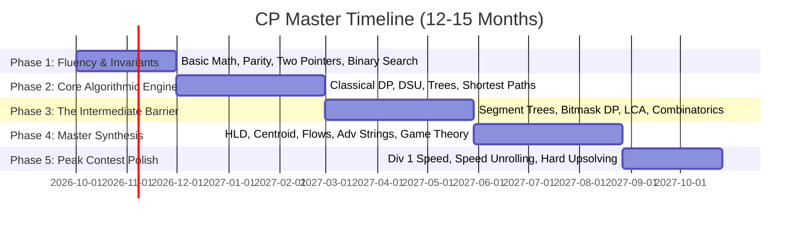

# Competitive Programming Master Blueprint: From 800 to Master (2100+), 6★, & Guardian

> **Target Outcomes:**
> - **Codeforces Master** (Rating 2100+, Top ~1.5% worldwide)
> - **CodeChef 6-Star** (Rating 2200+, Division 1)
> - **LeetCode Guardian / Knight+** (Rating 2150+, Top ~1%)
> - **Timeline:** 12 to 15 Months of Deliberate Practice

---

## 1. The Core Philosophy: How Intuition Actually Develops

Intuition is not an innate gift; it is **structured, associative pattern recognition** built upon hundreds of solved problems categorized by invariants.

### The Anti-Slop 4-Stage Problem-Solving Protocol
When facing an unfamiliar problem, strictly adhere to this sequence:

```
[00:00 - 10:00] Stage 1: Pen & Paper Reduction (No Code)
  └─ Extract small constraints (N=1, 2, 3, 4, 5).
  └─ Trace by hand. Find what is conserved (invariants) or strictly monotonic.
  └─ Explicitly state what to MAXIMIZE, MINIMIZE, COUNT, or CONSTRUCT.

[10:00 - 25:00] Stage 2: Complexity-Driven Hypothesis
  └─ Constraint audit: What big-O is permitted? (e.g. N <= 2e5 requires O(N) or O(N log N)).
  └─ Match the pattern: Monotonic predicate? Overlapping subproblems? Graph traversal?
  └─ Formulate algorithm & prove exchange argument or state transition on paper.

[25:00 - 40:00] Stage 3: The Independent Struggle (Where Growth Occurs)
  └─ DO NOT open the editorial.
  └─ If your approach fails on an edge case, trace WHY.
  └─ Test extreme inputs: all equal, alternating, maximum values, disconnected graph.

[40:00+] Stage 4: Progressive Unlocking & Upsolving
  └─ If completely stuck after 35-40 min: Read ONLY the topic tag or 1-line reduction.
  └─ Close the editorial and attempt implementation again.
  └─ Only inspect full code if still blocked after the hint.
  └─ Mandatory: Write an explanation in `explanations/<problem>.md` using Mermaid diagrams.
```

---

## 2. The 5-Phase Master Timeline



---

### **Phase 1: Fluency, Invariants & Search (Months 1–2 / Weeks 1–8)**
* **Targets:** Codeforces 1200–1300 (Pupil), LeetCode ~1650, CodeChef 3★ (1600).
* **Daily Volume:** 15–20 problems (transitioning from pure 800s to 1100–1300).
* **Core Topics & Reference Math:**
  1. **Number Theory & Arithmetic:**
     - Euclid's GCD & LCM ($O(\log(\min(A, B)))$).
     - Sieve of Eratosthenes ($O(N \log \log N)$) & Prime Factorization in $O(\sqrt{N})$.
     - Fast Modular Exponentiation ($a^b \pmod m$ in $O(\log b)$).
     - Parity, modular arithmetic rules $(A \pm B) \pmod M$, $(A \times B) \pmod M$.
  2. **Two Pointers & Sliding Window:**
     - Finding subarrays with sum/property conditions on monotonic arrays.
     - Fast duplicate removal, merge operations.
  3. **Prefix Sums & Difference Arrays:**
     - 1D & 2D Prefix Sums ($O(1)$ range sum queries).
     - 1D Difference Arrays ($O(1)$ range additive updates, $O(N)$ offline reconstruction).
  4. **Binary Search on Answer:**
     - Recognizing monotonicity: if predicate $P(x)$ is monotonic (F...F T...T), binary search the boundary.
  5. **Greedy Exchange Arguments:**
     - Proving that swapping adjacent out-of-order elements cannot improve the optimal cost.
* **Key Milestone Benchmarks:**
  - CSES Sorting and Searching: First 20 problems.
  - Solve Codeforces Div 2 Problems A & B within 25 minutes.

---

### **Phase 2: Core Algorithmic Engine & Classical DP (Months 3–5 / Weeks 9–20)**
* **Targets:** Codeforces 1400–1600 (Specialist $\to$ Expert), LeetCode 1850+ (**Knight**), CodeChef 4★ (1800).
* **Daily Volume:** 8–12 problems (higher thought intensity per problem).
* **Core Topics & Reference Math:**
  1. **Classical Dynamic Programming:**
     - **1D / Linear DP:** House Robber, Coin Change, Frog Jumps.
     - **0/1 Knapsack & Unbounded Knapsack:** State representation $dp[i][w]$ and space compression to 1D.
     - **Longest Increasing Subsequence (LIS):** $O(N^2)$ baseline $\to O(N \log N)$ via patience sorting / `lower_bound`.
     - **Grid DP & DAG DP:** Counting paths, minimum path sum.
     - **Subarray / Kadane's Algorithm:** Tracking local vs global optimal intervals.
  2. **Graphs & Trees Foundations:**
     - Breadth-First Search (BFS): Shortest path in unweighted graphs, multi-source BFS.
     - Depth-First Search (DFS): Connected components, cycle detection, bipartite testing via 2-coloring.
     - Topological Sort (Kahn's algorithm with in-degrees & DFS exit times).
     - Tree Traversals: Subtree sizes, node depths, tree diameter ($2 \times$ BFS/DFS).
  3. **Disjoint Set Union (DSU / Union-Find):**
     - Path compression + Union by rank/size ($O(\alpha(N))$ amortized).
     - Kruskal's Minimum Spanning Tree (MST).
  4. **Combinatorics & Bits:**
     - Pascal's identity, permutations & combinations with modulo $10^9+7$.
     - Bitwise operations: iterating over submasks of a mask in $O(3^N)$, finding lowest set bit `x & (-x)`.
* **Key Milestone Benchmarks:**
  - CSES Dynamic Programming (all 19 classical problems).
  - CSES Graph Algorithms: First 15 problems.
  - Consistent 3/4 solves in LeetCode Weekly contests (hitting Knight title).

---

### **Phase 3: The Intermediate Barrier & Tree/Range Structures (Months 6–8 / Weeks 21–32)**
* **Targets:** Codeforces 1700–1900 (**Candidate Master**), LeetCode 2150+ (**Guardian**), CodeChef 5★ (2000).
* **Daily Volume:** 5–8 problems (focus on Div 2 C/D and LeetCode Hard).
* **Core Topics & Reference Math:**
  1. **Advanced Range Query Structures:**
     - **Binary Indexed Tree (Fenwick Tree):** Point update, prefix query, inversion counting.
     - **Segment Tree:** Range sum/min/max with point updates in $O(\log N)$.
     - **Segment Tree with Lazy Propagation:** Range updates + range queries in $O(\log N)$.
     - **Monotonic Stack & Queue:** Next Greater Element, sliding window minimum.
  2. **Advanced Graph & Tree Algorithms:**
     - Dijkstra's Algorithm with `PriorityQueue` / Min-Heap ($O((V + E) \log V)$).
     - Bellman-Ford & Floyd-Warshall (all-pairs shortest paths in $O(V^3)$).
     - Lowest Common Ancestor (LCA) via Binary Lifting in $O(N \log N)$ prep, $O(\log N)$ query.
     - Euler Tour Technique: Flattening tree subtrees into 1D contiguous segments for Fenwick/Segment Tree.
  3. **Specialized DP Paradigms:**
     - **Digit DP:** Counting numbers in range $[L, R]$ satisfying digit constraints.
     - **Bitmask DP:** Traveling Salesperson Problem (TSP), assignment problems ($O(2^N \cdot N)$ for $N \le 20$).
     - **Tree DP:** Independent set on trees, calculating answer for every node via re-rooting DP.
     - **Interval DP:** Matrix chain multiplication, merging adjacent piles ($O(N^3)$).
  4. **Number Theory & Math:**
     - Modular Inverse via Fermat's Little Theorem ($a^{P-2} \equiv a^{-1} \pmod P$ for prime $P$).
     - Extended Euclidean Algorithm for non-prime moduli.
     - Matrix Exponentiation for linear recurrences in $O(K^3 \log N)$.
     - Game Theory: Sprague-Grundy theorem, Nim game XOR sum.
* **Key Milestone Benchmarks:**
  - CSES Range Queries (all 19 problems).
  - CSES Tree Algorithms (all 16 problems).
  - Regularly solving Div 2 A through D on Codeforces.

---

### **Phase 4: Master Synthesis, Decompositions & High-End Topics (Months 9–12 / Weeks 33–48)**
* **Targets:** Codeforces 2000–2150+ (**Master**), CodeChef 6★ (2200+).
* **Daily Volume:** 3–5 challenging problems (Div 2 E/F, Div 1 B/C).
* **Core Topics & Reference Math:**
  1. **Tree Decompositions:**
     - **Heavy-Light Decomposition (HLD):** Decomposing paths on trees into $O(\log N)$ segment tree intervals.
     - **Centroid Decomposition:** Divide-and-conquer on trees for path queries.
     - **DSU on Tree ("Sack"):** Answering offline subtree frequency queries in $O(N \log N)$.
  2. **Network Flow & Matchings:**
     - Dinic's Algorithm ($O(V^2 E)$ general, $O(E \sqrt{V})$ unit networks).
     - Max Flow = Min Cut theorem & bipartite matching reductions.
  3. **Advanced String Processing:**
     - String Hashing with double polynomial rolling hash.
     - KMP (Knuth-Morris-Pratt) & $\pi$-table (Prefix Function).
     - Z-Algorithm & Suffix Automaton / Trie.
  4. **Advanced Mathematics & Geometry:**
     - Convex Hull (Monotone Chain / Graham Scan in $O(N \log N)$).
     - Fast Fourier Transform (FFT) & Number Theoretic Transform (NTT) for polynomial multiplication in $O(N \log N)$.
     - Inclusion-Exclusion Principle with bitmasks.
* **Key Milestone Benchmarks:**
  - Breaking into Div 1 on Codeforces (exceeding 1900 rating threshold).
  - Consistently cracking CodeChef Starters Division 1.

---

## 3. Curated Resource Directory (No Noise, Only Signal)

### Problem Sets
1. **[CSES Problem Set](https://cses.fi/problemset/)** — The undisputed highest quality syllabus in competitive programming. Every problem teaches an indispensable classical archetype.
2. **[USACO Guide](https://usaco.guide/)** — The most comprehensive, free, well-structured competitive programming curriculum with editorial notes, prerequisites, and categorized problem links from Bronze to Platinum.
3. **[Codeforces EDU](https://codeforces.com/edu/courses)** — Masterclasses on Binary Search, Segment Trees, DSU, and Two Pointers created by ITMO instructors.
4. **[AtCoder Educational DP Contest](https://atcoder.jp/contests/dp)** — 26 problems (A through Z) covering every standard DP paradigm.

### Reference Textbooks
1. **Competitive Programmer's Handbook** by Antti Laaksonen ([Free PDF](https://cses.fi/book/book.pdf)).
2. **[CP-Algorithms (e-maxx)](https://cp-algorithms.com/)** — Comprehensive mathematical derivations and reference code for virtually all algorithms up to Grandmaster.

### Video Problem-Solving Intuition
1. **Errichto** (Ex-World Finalist) — Unequaled problem-solving thought breakdowns, binary search, and dynamic programming intuitions.
2. **Colin Galen** — Practical roadmaps, topic-by-topic difficulty ladders (from 1000 to 2000 rating).
3. **WilliamFiset** — Exceptional animations of complex graph and data structure mechanics.

---

## 4. How to Adjust Your Repo Tooling for Each Phase

As you progress through the phases, adjust [practice/plan.json](file:///d:/pro/CP/practice/plan.json):

### Current (Week 1–2):
```json
{
  "platforms": {
    "codeforces": { "startRating": 800, "ratingStepPerWeek": 100, "maxRating": 1600, "stretchCount": 3 },
    "leetcode": { "difficulty": "Easy" },
    "codechef": { "startRating": 800, "ratingStepPerWeek": 100, "maxRating": 1600 }
  }
}
```

### Transition to Phase 2 (Week 9+):
```json
{
  "perPlatformCount": 4,
  "platforms": {
    "codeforces": { "startRating": 1300, "ratingStepPerWeek": 50, "maxRating": 1900, "stretchCount": 2 },
    "leetcode": { "difficulty": "Medium" },
    "codechef": { "startRating": 1400, "ratingStepPerWeek": 50, "maxRating": 1900 }
  }
}
```

### Transition to Phase 3 & 4 (Week 25+):
```json
{
  "perPlatformCount": 2,
  "platforms": {
    "codeforces": { "startRating": 1700, "ratingStepPerWeek": 25, "maxRating": 2300, "stretchCount": 1 },
    "leetcode": { "difficulty": "Hard" },
    "codechef": { "startRating": 1800, "ratingStepPerWeek": 25, "maxRating": 2400 }
  }
}
```

---

## 5. The Golden Habits of Future Masters

1. **Upsolving is Non-Negotiable:** After every contest, solve **at least 1 problem above your current ceiling** (the first problem you failed to solve in contest).
2. **Keep Clean Stress Suites:** When stuck on "Wrong Answer on test 7", never guess — write an exhaustive brute-force reference and generator in `stress/<problem>_stress.js` to find the exact minimal counterexample.
3. **No Blind Submissions:** Before submitting, run worst-case edge cases ($N = 2 \cdot 10^5$, maximum numbers, degenerate shapes) through `.\run <problem>` to eliminate TLE and integer overflow risks.
