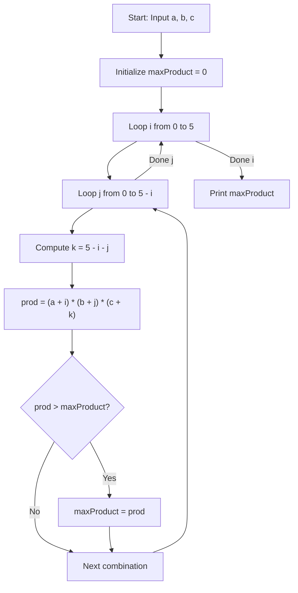
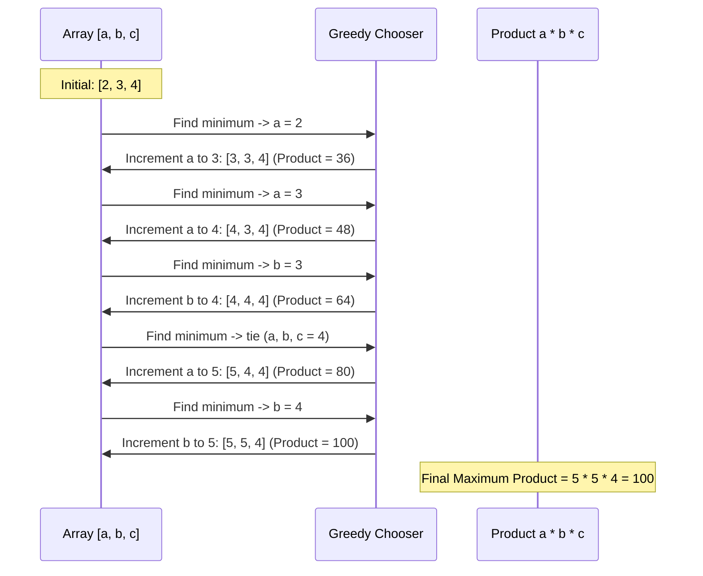

# Only Pluses (Codeforces 1992A)

## 1. Problem Overview
- **Platform:** Codeforces
- **Problem ID:** [1992A](https://codeforces.com/problemset/problem/1992/A)
- **Rating:** 800
- **Tags:** brute force, constructive algorithms, greedy, math, sortings
- **Solution File:** `onlyPluses.js`
- **Starter Template:** `templates/codeforces.js` / `cp.js`

---

## 2. Core Intuition & Mathematical Rationale

We are given three integers $a, b, c$ ($1 \le a, b, c \le 10$). We are allowed to perform at most $5$ operations: in each operation, we choose one integer and increment it by $1$. We want to maximize the final product:
$$\max (a + i) \cdot (b + j) \cdot (c + k) \quad \text{subject to} \quad i + j + k \le 5, \; i, j, k \ge 0$$

### Key Mathematical Observations
1. **Marginal Gain Analysis:**
   If we have a product $P = x \cdot y$, incrementing $x$ gives $(x + 1)y = P + y$. Incrementing $y$ gives $x(y + 1) = P + x$.
   The gain from incrementing $x$ is $y$, and the gain from incrementing $y$ is $x$.
   $$\text{Gain}(x) = y, \quad \text{Gain}(y) = x$$
   To maximize the gain at each step, we must always increment the **smallest** of the numbers.
2. **Equidistribution Principle:**
   For a fixed sum $S = (a + i) + (b + j) + (c + k)$, the product of terms is maximized when the terms are as close to each other as possible (AM-GM inequality).
3. **Search Space:**
   Even without any greedy assumptions, the number of non-negative integer partitions of $\le 5$ increments among 3 variables is:
   $$\binom{5 + 3}{3} = \binom{8}{3} = 56 \text{ combinations}$$
   Evaluating 56 combinations per testcase takes $\approx 50$ CPU operations, which is virtually instantaneous ($< 1$ microsecond).



---

## 3. Visual Step-by-Step Walkthrough

Consider Sample Test Case: $a = 2, b = 3, c = 4$ with 5 increments available.

### Greedy Increment Trace (Step-by-Step)


---

## 4. Algorithmic Complexity

| Metric | Complexity | Notes |
|---|:---:|---|
| **Time per Test Case** | $O(1)$ | Exact $\sum_{i=0}^5 (6 - i) = 21$ iterations. |
| **Total Time ($\sum$)** | $O(T)$ | For $T = 1000$, total iterations $\approx 2.1 \times 10^4 \ll 10^8$. Takes $< 10$ ms. |
| **Space Complexity** | $O(1)$ | No memory allocated inside the loop. |
| **Call Stack** | $O(1)$ | Simple iterative loop, 0 recursion depth. |

---

## 5. Edge Cases & Boundary Conditions
1. **Minimal values:** $a = 1, b = 1, c = 1$.
   Increments distribute to $3, 3, 2 \implies 3 \times 3 \times 2 = 18$.
2. **Unequal values:** $a = 10, b = 1, c = 10$.
   All 5 increments go to $b \implies b = 6 \implies 10 \times 6 \times 10 = 600$.
3. **Numeric Overflow:**
   Max possible product is $(10 + 5) \times 10 \times 10 \le 15^3 = 3375 \ll 2^{53} - 1$.
   Plain JavaScript `Number` fits with zero risk of truncation or loss of precision.

---

## 6. Reference Implementation
```javascript
const fs = require('fs');
const input = fs.readFileSync(0, 'utf-8').trim().split(/\r?\n/);
let inputIndex = 0;

const readLine = () => input[inputIndex++];
const readInt = () => parseInt(readLine(), 10);
const readIntArray = () => readLine().trim().split(/\s+/).map(Number);

const output = [];
const print = (val) => output.push(val);
const printAll = () => console.log(output.join('\n'));

function solve() {
  const T = readInt();
  for (let t = 0; t < T; t++) {
    const [a, b, c] = readIntArray();

    let maxProduct = 0;
    for (let i = 0; i <= 5; i++) {
      for (let j = 0; j <= 5 - i; j++) {
        const k = 5 - i - j;
        const prod = (a + i) * (b + j) * (c + k);
        if (prod > maxProduct) {
          maxProduct = prod;
        }
      }
    }

    print(maxProduct);
  }
}

solve();
printAll();
```
