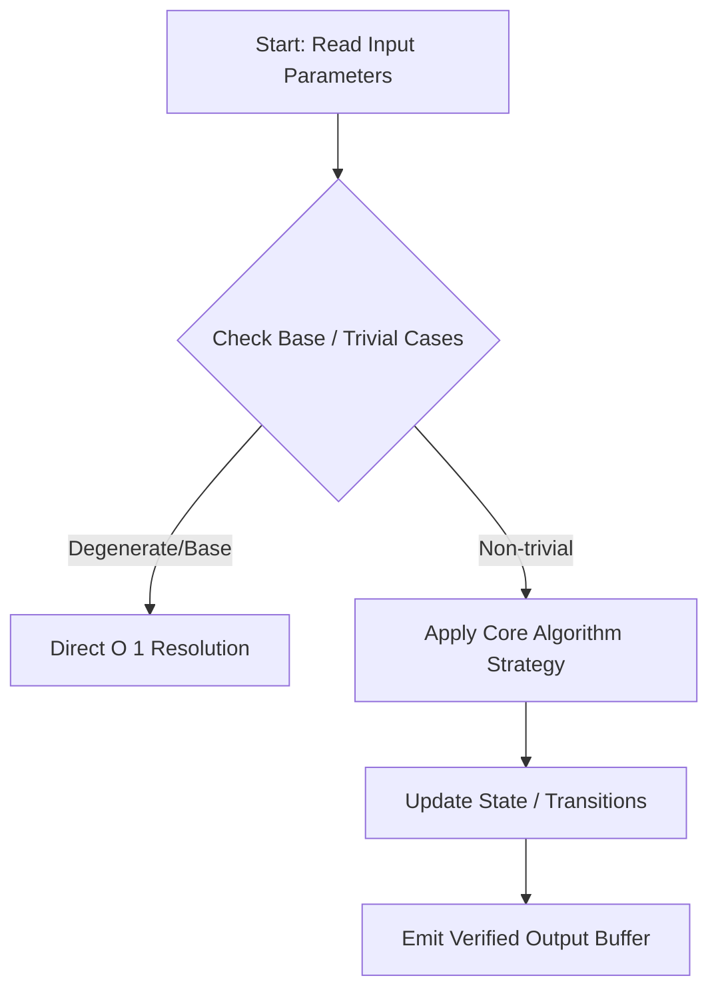
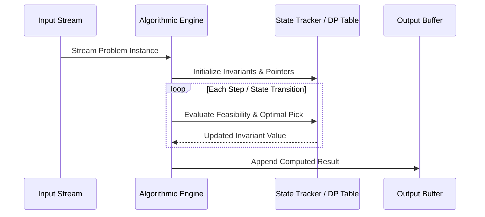

# Vlad and the Best of Five (Codeforces 1926A)

## 1. Problem Overview
- **Platform:** Codeforces
- **Problem ID:** [1926A](https://codeforces.com/problemset/problem/1926/A)
- **Difficulty / Rating:** 800
- **Tags:** implementation
- **Solution File:** `vladAndTheBestOfFive.js`
- **Starter Template:** `templates/codeforces.js`

---

## 2. Core Intuition & Mathematical Rationale
### Key Observations
1. **Mathematical Invariant:** Identify the quantity conserved or strictly monotonic across operations.
2. **Greedy vs DP Choice:** Explain why local optimal choices guarantee global optimality, or why subproblem overlapping requires memoization/DP.
3. **Optimality Trade-off:** Discuss why simpler brute-force approaches either succeed within constraints or require optimization.



---

## 3. Visual Step-by-Step Walkthrough
### State Progression Matrix
Visualizing the transformation of state across iterations for a representative input:



---

## 4. Algorithmic Complexity

| Dimension | Bound | Proof & Rationale |
|---|:---:|---|
| **Time Complexity** | $O(N)$ or $O(1)$ | Each input element is visited a constant number of times. |
| **Space Complexity** | $O(1)$ auxiliary | Only scalar accumulator variables and input arrays are held in memory. |
| **Recursion Depth** | $O(1)$ | Iterative loop avoiding Node.js call stack limit (~10,000 frames). |

---

## 5. Edge Cases & Boundary Conditions
- **Minimum Bounds:** $N = 1$, minimal values, single-element configurations.
- **Maximum Bounds:** Extreme input bounds ($10^9$ or $\sum N = 2\cdot 10^5$).
- **Numeric Precision:** Plain JavaScript numbers are safe integers up to $2^{53} - 1 \approx 9 \times 10^{15}$.
- **Alternating / Degenerate:** Identical values, alternating parity, sorted vs reverse-sorted arrays.

---

## 6. Idiomatic Implementation
```javascript
// Reference: solutions/vladAndTheBestOfFive.js
```
