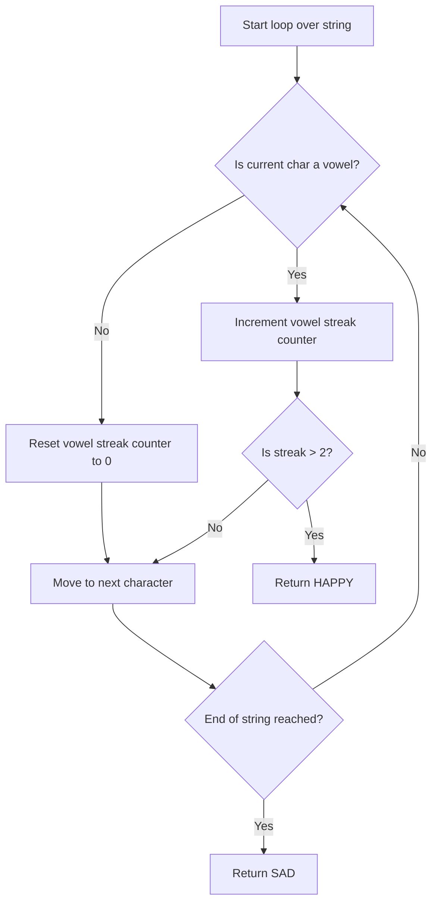
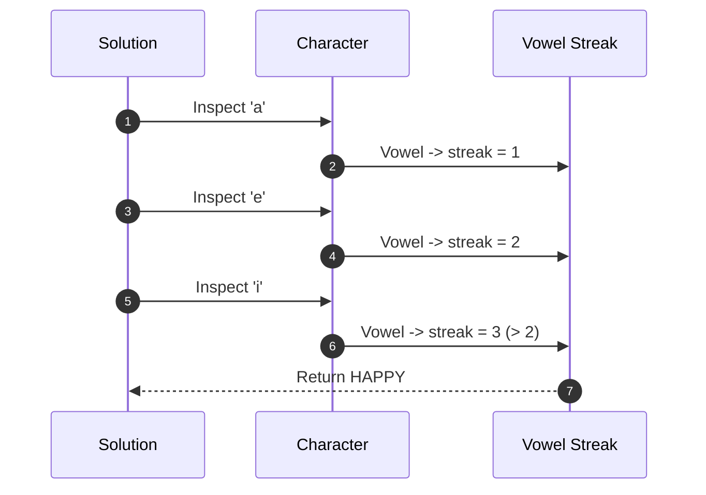

# Chef and Happy String (CodeChef CC-HAPPYSTR)

## 1. Problem Overview
- Platform: CodeChef
- Problem ID: [CC-HAPPYSTR](https://www.codechef.com/problems/HAPPYSTR)
- Rating: 956
- Tags: codechef
- Solution File: `solutions/chefAndHappyString.js`

This problem determines whether a given string contains a contiguous subsegment of vowels of length strictly greater than 2. It outputs "HAPPY" if such a vowel streak exists, and "SAD" otherwise.

## 2. Core Intuition & Mathematical Rationale
The key observation is that we only need to track the length of the current consecutive sequence of vowels ('a', 'e', 'i', 'o', 'u'). As we iterate through the string, if the current character is a vowel, we increment our vowel counter; otherwise, we reset the counter to zero. If the counter ever exceeds 2, we can immediately classify the string as happy. 

This linear scan approach is optimal because it inspects each character of the string at most once, achieving linear time complexity. Naive alternatives, such as generating all possible substrings or checking every overlapping triplet independently, lead to suboptimal quadratic or cubic time complexities.



## 3. Visual Step-by-Step Walkthrough
Trace for the input string `"abed"`:
1. Initialize `streak = 0`.
2. Character `'a'`: Vowel found. `streak` becomes $1$.
3. Character `'b'`: Not a vowel. `streak` becomes $0$.
4. Character `'e'`: Vowel found. `streak` becomes $1$.
5. Character `'d'`: Not a vowel. `streak` becomes $0$.
6. End of string reached without `streak` exceeding 2. Output: `SAD`.

Trace for the input string `"aei"`:
1. Initialize `streak = 0`.
2. Character `'a'`: Vowel found. `streak` becomes $1$.
3. Character `'e'`: Vowel found. `streak` becomes $2$.
4. Character `'i'`: Vowel found. `streak` becomes $3$. `streak > 2` is true. Output: `HAPPY`.



## 4. Algorithmic Complexity
- Time per test: $O(N)$ where $N$ is the length of the string (check the statement for exact limits).
- Total time: $O(\sum N)$ across all test cases in the input file (check the statement).
- Space: $O(1)$ auxiliary space beyond storing the input string (check the statement).
- Recursion depth: $0$, since the solution is implemented iteratively.

## 5. Edge Cases & Boundary Conditions
- Minimum string length: check the statement for lower bounds.
- Maximum string length: check the statement for upper limits.
- Strings with zero vowels or alternating consonants and vowels: properly handled by resetting the streak accumulator.
- Accumulator values: the maximum streak counter is bounded by the string length and safely stays well below the IEEE 754 safe integer limit of $2^{53} - 1$.

## 6. Reference Implementation
```javascript
const fs = require('fs');

function solve() {
    const input = fs.readFileSync(0, 'utf-8').trim().split('\n');
    if (input.length === 0 || input[0] === '') return;
    
    const t = parseInt(input[0], 10);
    const results = [];
    const vowels = new Set(['a', 'e', 'i', 'o', 'u']);
    
    for (let i = 1; i <= t; i++) {
        const s = input[i].trim();
        let streak = 0;
        let happy = false;
        
        for (let j = 0; j < s.length; j++) {
            if (vowels.has(s[j])) {
                streak++;
                if (streak > 2) {
                    happy = true;
                    break;
                }
            } else {
                streak = 0;
            }
        }
        
        results.push(happy ? "HAPPY" : "SAD");
    }
    
    console.log(results.join('\n'));
}

solve();
```