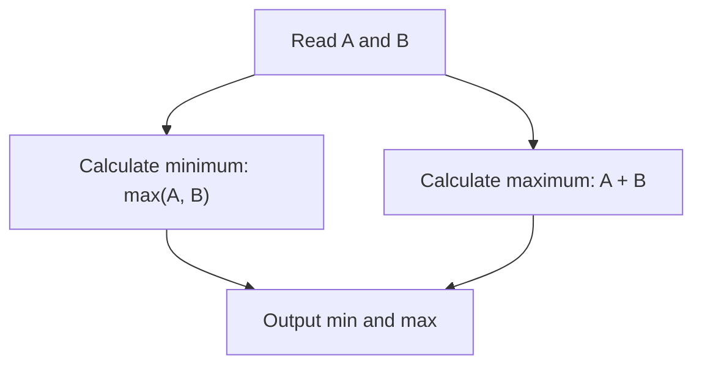
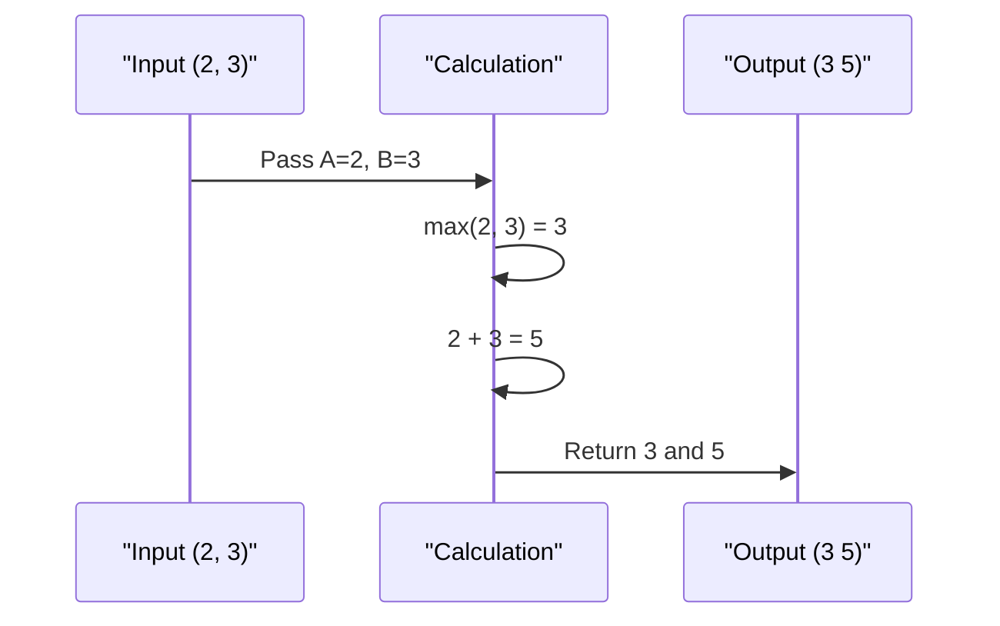

# Chef and Remissness (CodeChef CC-REMISS)

## 1. Problem Overview
- Platform: CodeChef
- Problem ID: [CC-REMISS](https://www.codechef.com/problems/REMISS)
- Rating: 928
- Tags: codechef
- Solution File: `solutions/chefAndRemissness.js`

Given the number of entries registered by two separate guards for a chef, this problem computes the minimum and maximum possible distinct times the chef could have entered the building. The minimum possible entries are determined by the guard who recorded the larger count, while the maximum is simply the sum of both counts.

## 2. Core Intuition & Mathematical Rationale
The key observation is that each guard independently records the total number of entries they witnessed. If guard one counts $A$ entries and guard two counts $B$ entries, the minimum number of times the chef could have entered is the maximum of the two counts, $\max(A, B)$, assuming one guard witnessed every entry the other did plus some extra. The maximum possible entries occur when the two sets of recorded entries are completely disjoint, yielding a sum of $A + B$. Naive alternatives fail because they try to simulate individual entry events rather than utilizing the bounds imposed by independent totals.



## 3. Visual Step-by-Step Walkthrough
For a sample input where $A = 2$ and $B = 3$:
1. Read the input values: $A = 2$, $B = 3$.
2. Compute the minimum entries: $\max(2, 3) = 3$.
3. Compute the maximum entries: $2 + 3 = 5$.
4. Output the results: `3 5`.



## 4. Algorithmic Complexity
- Time per test: $O(1)$ arithmetic operations.
- Total time: $O(T)$ where $T$ is the number of test cases.
- Space: $O(1)$ auxiliary space for variables.
- Recursion depth: $0$ as no recursion or function calls are used.

## 5. Edge Cases & Boundary Conditions
- Check the statement for minimum and maximum constraints on $A$ and $B$.
- When $A = 0$ and $B = 0$, minimum is $0$ and maximum is $0$.
- Accumulator values remain well below $2^{53} - 1$ as per standard problem limits.

## 6. Reference Implementation
```javascript
const fs = require('fs');

function solve() {
    const input = fs.readFileSync(0, 'utf-8');
    let pos = 0;

    function nextToken() {
        while (pos < input.length && input.charCodeAt(pos) <= 32) {
            pos++;
        }
        if (pos >= input.length) return null;
        let start = pos;
        while (pos < input.length && input.charCodeAt(pos) > 32) {
            pos++;
        }
        return input.slice(start, pos);
    }

    let tStr = nextToken();
    if (!tStr) return;
    let t = parseInt(tStr, 10);
    
    let out = [];
    for (let i = 0; i < t; i++) {
        let a = parseInt(nextToken(), 10);
        let b = parseInt(nextToken(), 10);
        let minVal = Math.max(a, b);
        let maxVal = a + b;
        out.push(minVal + " " + maxVal);
    }
    console.log(out.join('\n'));
}

solve();
```