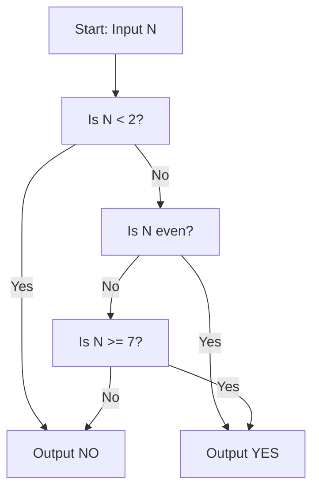
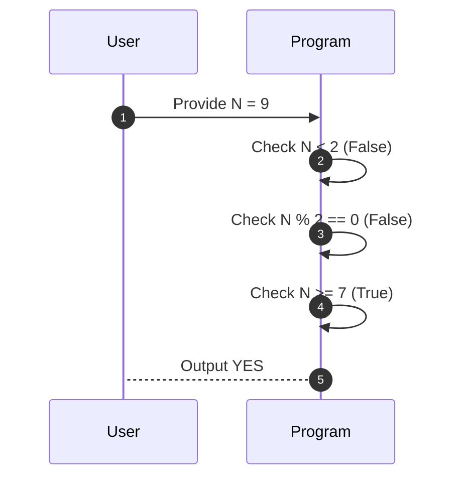

# Construct N (CodeChef CC-CONN)

## 1. Problem Overview
- Platform: CodeChef
- Problem ID: [CC-CONN](https://www.codechef.com/problems/CONN)
- Rating: 860
- Tags: codechef
- Solution File: `solutions/constructN.js`

This problem determines whether a given integer $N$ can be expressed as a non-negative integer combination of the numbers 2 and 7. It evaluates the parity and magnitude of $N$ to decide if a valid construction exists.

## 2. Core Intuition & Mathematical Rationale
The key observation is that any even integer greater than or equal to 2 can be formed using only 2s. Conversely, any odd integer requires at least one 7 because the sum of any quantity of 2s is always even. For an odd number to be valid, subtracting 7 must leave a non-negative even number, which requires $N \ge 7$ and $N$ being odd. Thus, numbers like 1, 3, and 5 are impossible, while all other integers $\ge 2$ can be constructed.



## 3. Visual Step-by-Step Walkthrough
Trace for $N = 5$:
1. Check if $5 < 2$ (False).
2. Check if $5$ is even (False).
3. Check if $5 \ge 7$ (False).
4. Output `NO`.

Trace for $N = 9$:
1. Check if $9 < 2$ (False).
2. Check if $9$ is even (False).
3. Check if $9 \ge 7$ (True).
4. Output `YES` ($9 = 7 + 2 \times 1$).



## 4. Algorithmic Complexity
- Time per test case: $\mathcal{O}(1)$ via direct conditional checks.
- Total time: $\mathcal{O}(T)$ for $T$ test cases processed sequentially.
- Space complexity: $\mathcal{O}(1)$ auxiliary space for variables.
- Recursion depth: $\mathcal{O}(1)$ since the solution is entirely iterative.

## 5. Edge Cases & Boundary Conditions
- Minimum input $N = 1$ correctly yields NO as it falls below 2.
- Small odd inputs $N = 3$ and $N = 5$ correctly yield NO as they are less than 7.
- Maximum input values are bounded by constraints; check the statement for exact limits.
- All numbers fit well within JavaScript's safe integer limit of $2^{53} - 1$.

## 6. Reference Implementation
```javascript
const fs = require('fs');

function solve() {
    const input = fs.readFileSync(0, 'utf-8').trim().split(/\s+/);
    if (input.length === 0 || input[0] === '') return;

    let t = parseInt(input[0], 10);
    let ptr = 1;
    let results = [];

    while (t > 0 && ptr < input.length) {
        let n = parseInt(input[ptr++], 10);
        if (n < 2) {
            results.push("NO");
        } else if (n % 2 === 0) {
            results.push("YES");
        } else if (n >= 7) {
            results.push("YES");
        } else {
            results.push("NO");
        }
        t--;
    }

    console.log(results.join('\n'));
}

solve();
```