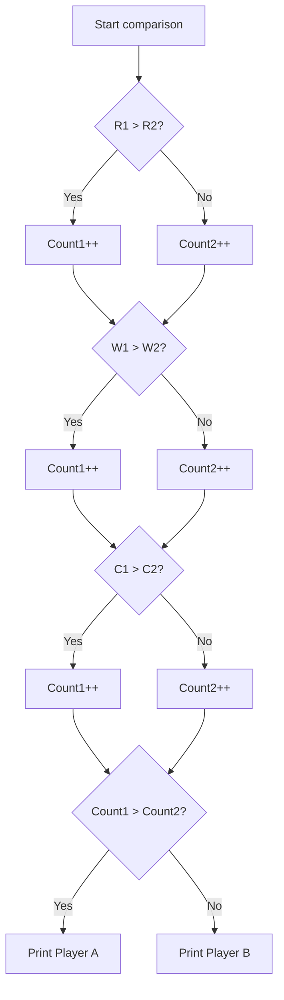
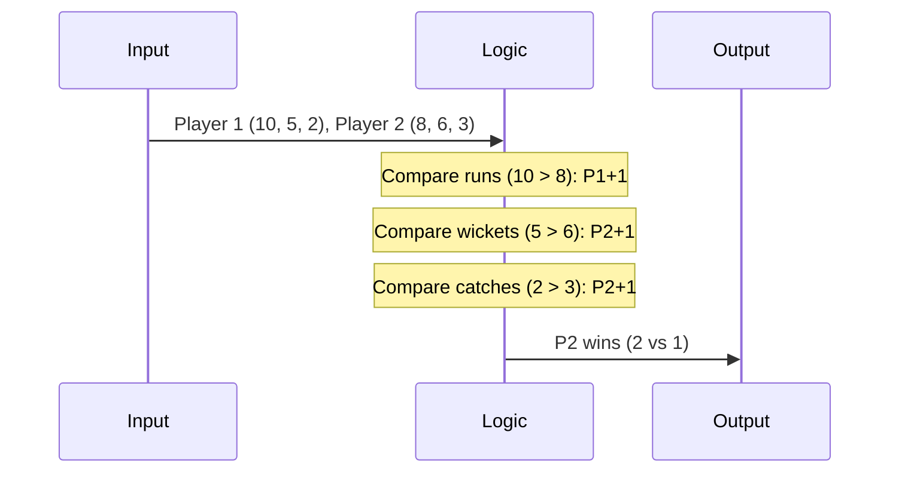

# Cricket Ranking (CodeChef CC-CRICRANK)

## 1. Problem Overview
- Platform: CodeChef
- Problem ID: [CC-CRICRANK](https://www.codechef.com/problems/CRICRANK)
- Rating: 966
- Tags: codechef
- Solution File: `solutions/cricketRanking.js`

We are given the performance statistics of two cricket players across three categories: runs, wickets, and catches. The problem requires us to determine which player wins more categories and output the name of the winning player.

## 2. Core Intuition & Mathematical Rationale
The key observation is that a player wins a category if their statistic is strictly greater than the opponent's statistic in that same category. Since there are three independent categories (runs, wickets, catches), we can independently compare $R_1 > R_2$, $W_1 > W_2$, and $C_1 > C_2$, counting how many categories player 1 wins. 

This approach is optimal because it runs in $O(1)$ time with a constant number of comparisons. Naive alternatives like sorting or complex data structures fail because they introduce unnecessary overhead for a fixed set of three comparisons.



## 3. Visual Step-by-Step Walkthrough
Consider a test case where Player A has stats $R_1=10, W_1=5, C_1=2$ and Player B has stats $R_2=8, W_2=6, C_2=3$.
1. Compare runs: $10 > 8$ is true. Player A wins 1 category.
2. Compare wickets: $5 > 6$ is false. Player B wins 1 category.
3. Compare catches: $2 > 3$ is false. Player B wins 1 category.
4. Total categories won: Player A has 1, Player B has 2. Player B wins.



## 4. Algorithmic Complexity
- Time per test: $O(1)$ arithmetic operations.
- Total time: $O(T)$ where $T$ is the number of test cases.
- Space: $O(1)$ auxiliary space for storing variables.
- recursion depth: $0$ as no recursion is used.

## 5. Edge Cases & Boundary Conditions
- Minimum inputs where all stats are zero: handled correctly by equality checks resulting in zero wins for Player 1, defaulting to Player 2.
- Maximum inputs within constraints: well within $2^{53} - 1$ as cricket stats are small integers fitting standard number types.
- Tied categories: check the statement for tie-breaking rules if applicable.

## 6. Reference Implementation
```javascript
const fs = require('fs');

function solve() {
    const input = fs.readFileSync(0, 'utf-8');
    let pos = 0;

    function nextToken() {
        while (pos < input.length && input.charCodeAt(pos) <= 32) {
            pos++;
        }
        if (pos >= input.length) return null;
        let start = pos;
        while (pos < input.length && input.charCodeAt(pos) > 32) {
            pos++;
        }
        return input.slice(start, pos);
    }

    let tStr = nextToken();
    if (!tStr) return;
    let t = parseInt(tStr, 10);
    let out = [];

    for (let i = 0; i < t; i++) {
        let r1 = parseInt(nextToken(), 10);
        let w1 = parseInt(nextToken(), 10);
        let c1 = parseInt(nextToken(), 10);
        let r2 = parseInt(nextToken(), 10);
        let w2 = parseInt(nextToken(), 10);
        let c2 = parseInt(nextToken(), 10);

        let p1Wins = 0;
        if (r1 > r2) p1Wins++;
        if (w1 > w2) p1Wins++;
        if (c1 > c2) p1Wins++;

        if (p1Wins >= 2) {
            out.push("A");
        } else {
            out.push("B");
        }
    }

    process.stdout.write(out.join('\n') + '\n');
}

solve();
```