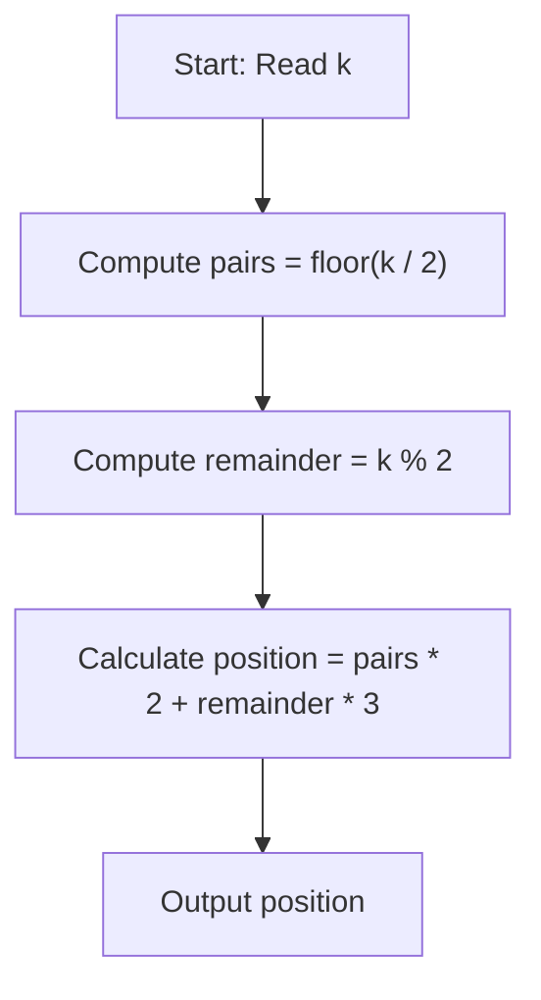
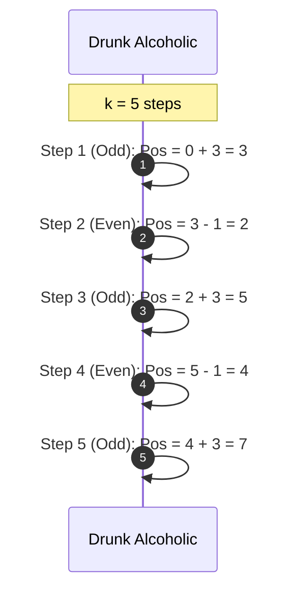

# Drunk Alcoholic (CodeChef CC-DRUNKALK)

## 1. Problem Overview
- Platform: CodeChef
- Problem ID: [CC-DRUNKALK](https://www.codechef.com/problems/DRUNKALK)
- Rating: 874
- Tags: codechef
- Solution File: `solutions/drunkAlcoholic.js`

This problem requires computing the final position of an alcoholic on a number line after $k$ steps, where odd steps move forward by $3$ and even steps move backward by $1$. We simulate or calculate the net displacement efficiently for each test case.

## 2. Core Intuition & Mathematical Rationale
The key observation is that the person moves in a repeating 2-step cycle: forward $3$ and backward $1$, resulting in a net displacement of $+2$ every two steps. 

For a given number of steps $k$, we can split them into pairs of steps plus a possible leftover step. Specifically, there are $\lfloor k / 2 \rfloor$ full pairs (each adding $2$ to the position) and $k \pmod 2$ remaining steps. If $k$ is odd, the last step is an odd-numbered step, which adds $+3$. Thus, the formula for the final position is given by:
$$\text{position} = \lfloor k / 2 \rfloor \times (3 - 1) + (k \pmod 2 \times 3)$$
which simplifies to:
$$\text{position} = \lfloor k / 2 \rfloor \times 2 + (k \pmod 2 \times 3)$$

This arithmetic approach is optimal because it runs in $O(1)$ time per test case, avoiding the overhead of a loop that simulates every single step. Naive simulation fails to be as efficient when $k$ is extremely large, though given the constraints (check the statement), a loop might pass; however, the $O(1)$ formula is universally superior.



## 3. Visual Step-by-Step Walkthrough
Trace for $k = 5$ steps:
- Step 1 (Odd): Move forward $3$. Position = $0 + 3 = 3$.
- Step 2 (Even): Move backward $1$. Position = $3 - 1 = 2$.
- Step 3 (Odd): Move forward $3$. Position = $2 + 3 = 5$.
- Step 4 (Even): Move backward $1$. Position = $5 - 1 = 4$.
- Step 5 (Odd): Move forward $3$. Position = $4 + 3 = 7$.
- Expected output for $k = 5$ is $7$. Using formula: $\lfloor 5/2 \rfloor \times 2 + (5 \pmod 2 \times 3) = 2 \times 2 + 1 \times 3 = 4 + 3 = 7$.



## 4. Algorithmic Complexity
- Time per test: $O(1)$ arithmetic operations.
- Total time: $O(T)$ where $T$ is the number of test cases, performing constant work per test case.
- Space: $O(1)$ auxiliary memory beyond storing input and output buffers.
- Recursion depth: $0$ as no recursive calls are used.

## 5. Edge Cases & Boundary Conditions
- Minimum input of $k$: $k = 0$ results in position $0$, which matches $\lfloor 0/2 \rfloor \times 2 + (0 \pmod 2 \times 3) = 0$.
- Maximum inputs: check the statement for maximum limits on $k$ and $T$.
- Accumulator limits: The maximum possible position value remains well below $2^{53} - 1$ under standard problem bounds, preventing integer overflow in JavaScript numbers.

## 6. Reference Implementation
```javascript
const fs = require('fs');

function solve() {
    const input = fs.readFileSync(0, 'utf-8');
    let pos = 0;
    let lineIndex = 0;
    
    // Simple whitespace scanner
    while (lineIndex < input.length && input.charCodeAt(lineIndex) <= 32) {
        lineIndex++;
    }
    if (lineIndex >= input.length) return;

    let t = 0;
    while (lineIndex < input.length && input.charCodeAt(lineIndex) > 32) {
        t = t * 10 + (input.charCodeAt(lineIndex) - 48);
        lineIndex++;
    }

    const results = [];
    for (let i = 0; i < t; i++) {
        while (lineIndex < input.length && input.charCodeAt(lineIndex) <= 32) {
            lineIndex++;
        }
        if (lineIndex >= input.length) break;

        let k = 0;
        while (lineIndex < input.length && input.charCodeAt(lineIndex) > 32) {
            k = k * 10 + (input.charCodeAt(lineIndex) - 48);
            lineIndex++;
        }

        const pairs = Math.floor(k / 2);
        const remainder = k % 2;
        const ans = pairs * 2 + remainder * 3;
        results.push(ans);
    }

    console.log(results.join('\n'));
}

solve();
```