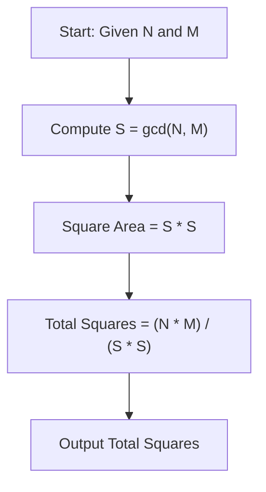
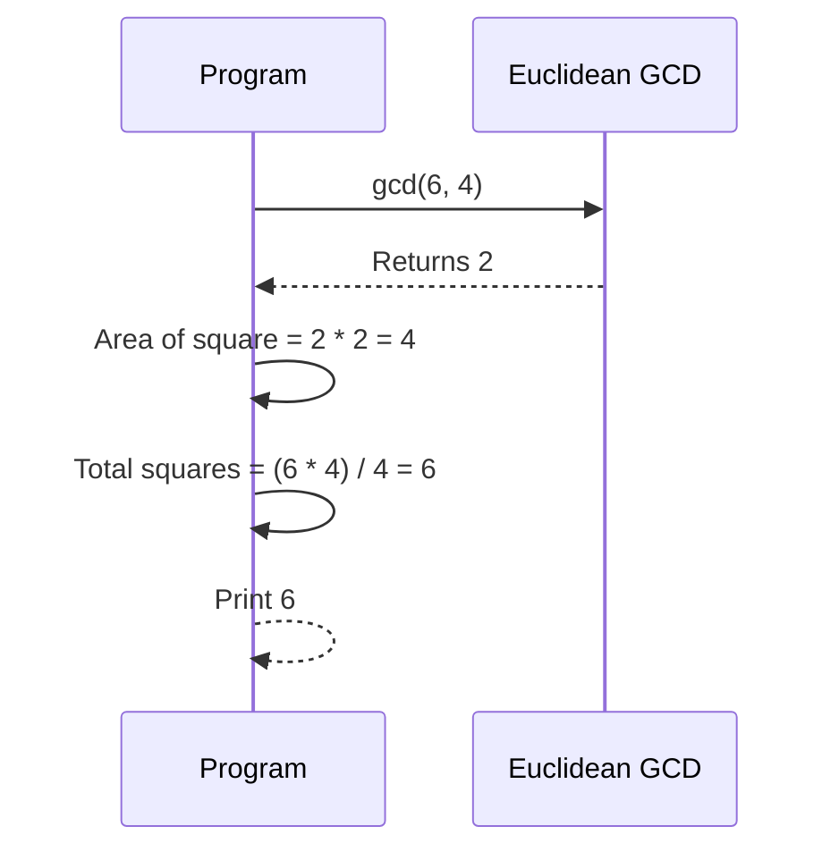

# Farmer And His Plot (CodeChef CC-RECTSQ)

## 1. Problem Overview
- Platform: CodeChef
- Problem ID: [RECTSQ](https://www.codechef.com/problems/RECTSQ)
- Rating: 936
- Tags: codechef
- Solution File: `solutions/farmerAndHisPlot.js`

Given a rectangular plot of land with dimensions $N$ and $M$, we need to divide it into the minimum possible number of identical square plots without any leftover land. The solution computes the greatest common divisor of $N$ and $M$ to determine the maximum possible side length of the square, and then divides the total area of the rectangle by the area of one such square.

## 2. Core Intuition & Mathematical Rationale
To minimize the number of square plots, the side length of the squares must be maximized. Since the land must be completely covered by identical squares of side length $S$, $S$ must divide both $N$ and $M$ without a remainder. To make $S$ as large as possible, it must be the greatest common divisor of $N$ and $M$, denoted as $\gcd(N, M)$. 

Naive alternatives, such as testing every possible side length from $1$ up to $\min(N, M)$, are too slow when $N$ and $M$ are large. Euclidean algorithm computes the $\gcd$ in logarithmic time, making it optimal.



## 3. Visual Step-by-Step Walkthrough
Consider a plot with dimensions $N = 6$ and $M = 4$.

1. Compute $S = \gcd(6, 4) = 2$.
2. The side length of each square plot is $2$.
3. The area of one square plot is $2 \times 2 = 4$.
4. The total area of the rectangle is $6 \times 4 = 24$.
5. The number of square plots is $24 / 4 = 6$.



## 4. Algorithmic Complexity
- Time per test: $O(\log(\min(N, M)))$ arithmetic operations for the Euclidean algorithm.
- Total time: $O(T \log(\min(N, M)))$ for $T$ test cases, well within the time limit.
- Space: $O(1)$ auxiliary space beyond input and output buffers.
- Recursion depth: $O(1)$ if implemented iteratively, or $O(\log(\min(N, M)))$ if implemented recursively.

## 5. Edge Cases & Boundary Conditions
- Minimum inputs: $N = 1, M = 1$ yields $\gcd(1, 1) = 1$ and $1$ square plot.
- Prime dimensions: If $N$ and $M$ are coprime, $\gcd(N, M) = 1$, resulting in $N \times M$ squares of size $1 \times 1$.
- Maximum accumulator values: $N$ and $M$ fit well within standard integer limits, so $N \times M$ does not exceed $2^{53} - 1$.

## 6. Reference Implementation
```javascript
const fs = require('fs');

function solve() {
    const input = fs.readFileSync(0, 'utf-8');
    let pos = 0;

    function nextInt() {
        while (pos < input.length && input.charCodeAt(pos) <= 32) {
            pos++;
        }
        if (pos >= input.length) return null;
        let res = 0;
        while (pos < input.length && input.charCodeAt(pos) > 32) {
            res = res * 10 + (input.charCodeAt(pos) - 48);
            pos++;
        }
        return res;
    }

    const t = nextInt();
    if (t === null) return;
    const out = [];

    function gcd(a, b) {
        while (b !== 0) {
            let temp = b;
            b = a % b;
            a = temp;
        }
        return a;
    }

    for (let i = 0; i < t; i++) {
        const n = nextInt();
        const m = nextInt();
        const s = gcd(n, m);
        const ans = (n / s) * (m / s);
        out.push(ans);
    }

    process.stdout.write(out.join('\n') + '\n');
}

solve();
```