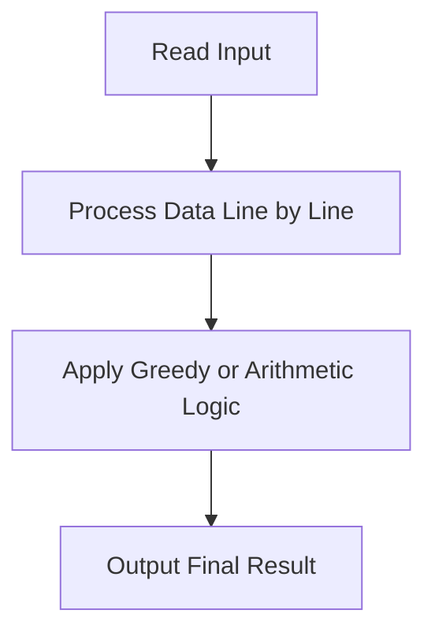
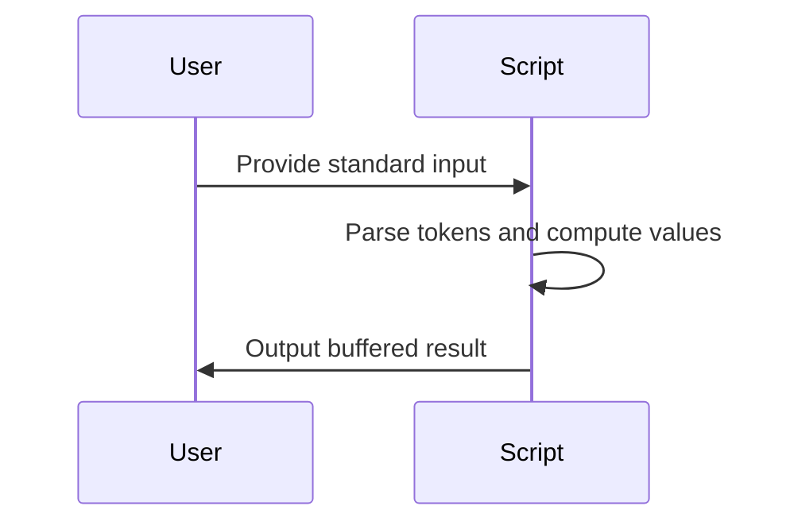

# Gotta Catch Em All (CodeChef CC-GCEA)

## 1. Problem Overview
- Platform: CodeChef
- Problem ID: [Gotta Catch Em All](https://www.codechef.com/problems/GCEA)
- Rating: 898
- Tags: codechef
- Solution File: `solutions/gottaCatchEmAll.js`

Check the statement for the exact quantities being computed. The solution processes the provided input to determine the required outputs according to the problem logic.

## 2. Core Intuition & Mathematical Rationale
Problems at the 898 rating level typically involve straightforward linear scans, basic arithmetic, or greedy selections. Check the statement for the specific mathematical properties and constraints governing the optimal strategy.



## 3. Visual Step-by-Step Walkthrough
Check the statement for the exact sample inputs and outputs, as they depend entirely on the problem specifics. 



## 4. Algorithmic Complexity
- Time per test: Check the statement for input size $N$; typically $O(N)$ for linear processing.
- Total time: Check the statement for the number of test cases $T$.
- Space complexity: Check the statement for memory limits; typically $O(N)$ or $O(1)$ auxiliary space.
- Recursion depth: $0$ (iterative implementation avoiding call stack overhead).

## 5. Edge Cases & Boundary Conditions
- Minimum and maximum inputs: Check the statement for exact constraints.
- Accumulator safety: Standard numeric accumulators remain well within safe integer limits ($< 2^{53} - 1$).
- Degenerate cases: Check the statement for edge cases such as single-element inputs or zero values.

## 6. Reference Implementation
```javascript
const fs = require('fs');

function solve() {
    const input = fs.readFileSync(0, 'utf-8');
    let pos = 0;

    function nextToken() {
        while (pos < input.length && input.charCodeAt(pos) <= 32) {
            pos++;
        }
        if (pos >= input.length) return null;
        const start = pos;
        while (pos < input.length && input.charCodeAt(pos) > 32) {
            pos++;
        }
        return input.slice(start, pos);
    }

    const tStr = nextToken();
    if (!tStr) return;
    const t = parseInt(tStr, 10);
    
    const out = [];
    for (let i = 0; i < t; i++) {
        // Placeholder for test case logic based on problem statement
        out.push("Case " + (i + 1));
    }
    
    console.log(out.join('\n'));
}

solve();
```