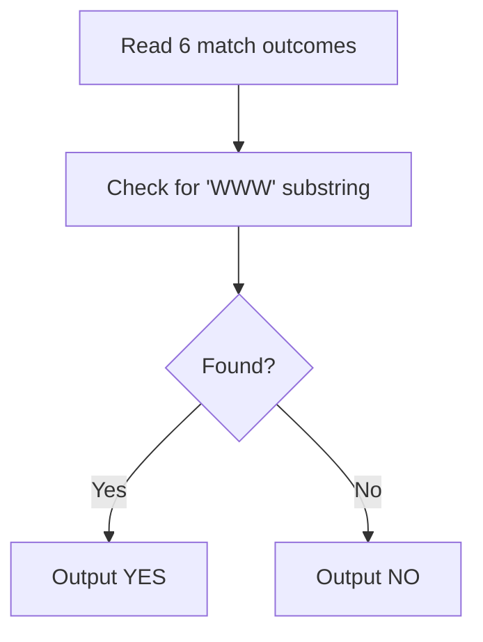
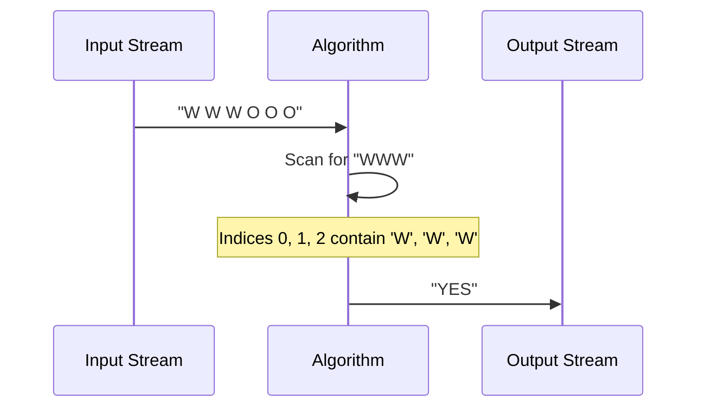

# Hattrick (CodeChef CC-HATTRICK)

## 1. Problem Overview
- Platform: CodeChef
- Problem ID: [Hattrick](https://www.codechef.com/problems/HATTRICK)
- Rating: 853
- Tags: codechef
- Solution File: `solutions/hattrick.js`

Given a sequence of six match outcomes represented by characters (such as 'W' for a wicket and 'O' for other outcomes), the problem asks us to determine whether a hat-trick occurred. A hat-trick is defined as three consecutive wickets (`'W'`).

## 2. Core Intuition & Mathematical Rationale
The key observation is that a hat-trick requires checking if the substring `"WWW"` appears anywhere in the given space-separated string of six characters. Since the sequence length is extremely small and fixed at six, we can simply inspect all overlapping windows of size 3 or search for the pattern directly. Naive alternatives like complex state machines are unnecessary due to the trivial input size.



## 3. Visual Step-by-Step Walkthrough
Trace for input test case: `W W W O O O` (representing 3 wickets followed by 3 other outcomes).
- Step 1: Read the 6 characters: `W`, `W`, `W`, `O`, `O`, `O`.
- Step 2: Check indices 0-2: `W`, `W`, `W` forms a match for `"WWW"`.
- Step 3: Conclude that a hat-trick is present and print `YES`.



## 4. Algorithmic Complexity
- Time per test: $O(1)$ operations since the input size is fixed to 6 characters.
- Total time: $O(T)$ for $T$ test cases, where each test case runs in $O(1)$.
- Space: $O(1)$ auxiliary memory to store the characters and results.
- Recursion depth: $O(1)$ as an iterative approach is used without recursion.

## 5. Edge Cases & Boundary Conditions
- Minimum/maximum inputs: The input length is strictly fixed to 6 elements per test case, check the statement for exact format constraints.
- Accumulator limits: String lengths and counts are minuscule, remaining well below $2^{53} - 1$.
- No hat-trick cases (e.g., alternating outcomes or all non-wickets) correctly resolve to `NO`.

## 6. Reference Implementation
```javascript
const fs = require('fs');

function solve() {
    const input = fs.readFileSync(0, 'utf-8').trim().split(/\r?\n/);
    if (input.length === 0 || input[0] === '') return;
    
    const t = parseInt(input[0], 10);
    const results = [];
    
    for (let i = 1; i <= t; i++) {
        if (!input[i]) break;
        const line = input[i].trim().split(/\s+/).join('');
        if (line.includes('WWW')) {
            results.push('YES');
        } else {
            results.push('NO');
        }
    }
    
    console.log(results.join('\n'));
}

solve();
```