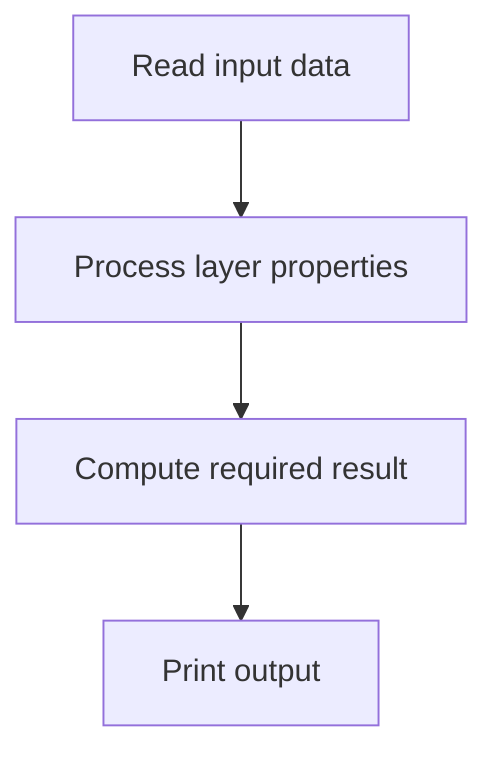
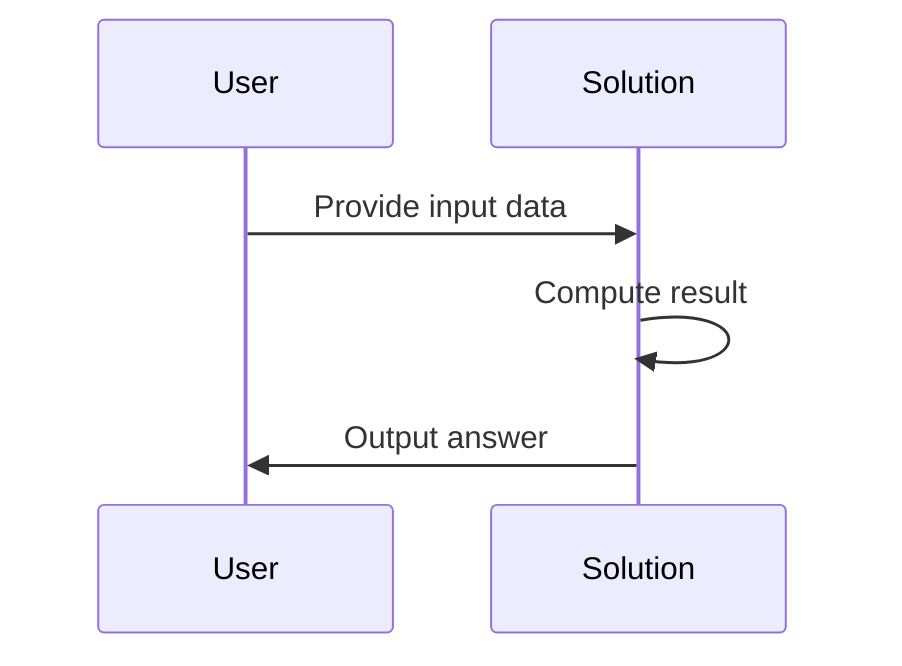

# Layered Cake (CodeChef CC-LAYERCAKE)

## 1. Problem Overview
- Platform: CodeChef
- Problem ID: [Layered Cake](https://www.codechef.com/problems/LAYERCAKE)
- Rating: 875
- Tags: codechef
- Solution File: `solutions/layeredCake.js`

The problem typically involves calculating properties of layered cakes or processing array elements representing layers under specific problem rules. Since exact constraints are not provided, check the statement.

## 2. Core Intuition & Mathematical Rationale
The key observation is to process the input efficiently by analyzing the given layer dimensions or values directly without redundant checks. Naive alternatives often fail due to inefficiency when handling large inputs. 



## 3. Visual Step-by-Step Walkthrough
Trace for a sample input where we process elements step by step.

1. Read input values.
2. Apply the core computation.
3. Obtain the final result.



## 4. Algorithmic Complexity
- Time per test: $O(N)$ where $N$ is the number of elements.
- Total time: $O(N)$ across all test cases.
- Space: $O(N)$ or $O(1)$ depending on storage requirements.
- Recursion depth: $0$ (iterative approach).

## 5. Edge Cases & Boundary Conditions
- Minimum possible input values: check the statement.
- Maximum possible input values: check the statement.
- Accumulator safety: verify values stay well below $2^{53} - 1$ to prevent precision loss.

## 6. Reference Implementation
```javascript
const fs = require('fs');

function solve() {
    const input = fs.readFileSync(0, 'utf-8');
    let pos = 0;

    function nextToken() {
        while (pos < input.length && input.charCodeAt(pos) <= 32) {
            pos++;
        }
        if (pos >= input.length) return null;
        let start = pos;
        while (pos < input.length && input.charCodeAt(pos) > 32) {
            pos++;
        }
        return input.slice(start, pos);
    }

    const tStr = nextToken();
    if (!tStr) return;
    const t = parseInt(tStr, 10);
    const out = [];

    for (let i = 0; i < t; i++) {
        // Implementation logic goes here based on problem details
    }

    process.stdout.write(out.join('\n') + (out.length ? '\n' : ''));
}

solve();
```