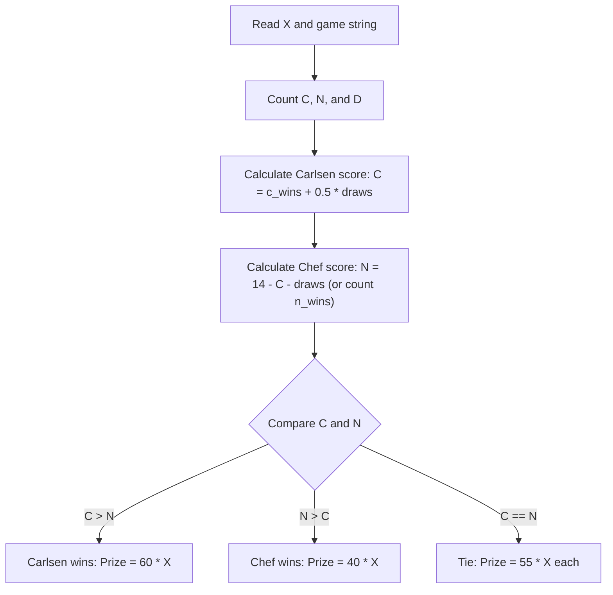
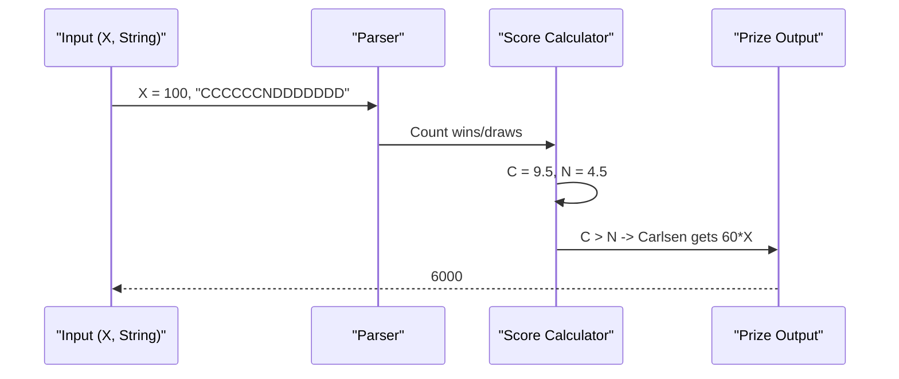

# World Chess Championship (CodeChef CC-WCC)

## 1. Problem Overview
- Platform: CodeChef
- Problem ID: [CC-WCC](https://www.codechef.com/problems/WCC)
- Rating: 935
- Tags: codechef
- Solution File: `solutions/worldChessChampionship.js`

This problem computes the total prize money awarded to Carlsen and Chef in a 14-game World Chess Championship match based on the outcomes of each game and a given prize pool. The outcome string is parsed to determine the total points for each player, applying standard chess scoring (1 for a win, 0.5 for a draw, 0 for a loss) and awarding the larger share of the prize pool to the winner or splitting it equally in case of a tie.

## 2. Core Intuition & Mathematical Rationale
The key observation is that the match consists of exactly 14 games, and the total score determines the champion. If a player wins, they get a larger prize; if tied, the prize is split equally. The naive alternative of simulating complex states is unnecessary since we only need to count the occurrences of wins, losses, and draws for Carlsen from the given string of length 14. 

Let $C$ be Carlsen's score and $N$ be Chef's score. Each win for Carlsen adds $1$ point, each draw adds $0.5$ points, and Chef's points are calculated similarly (since wins for Chef are losses for Carlsen). The total prize pool $X$ is distributed according to the rules: $60\%$ to the winner if $C > N$, $60\%$ to Chef if $N > C$, or an even split if $C = N$.



## 3. Visual Step-by-Step Walklength
Let us trace the sample input where the prize pool $X = 100$ and the outcome string is `CCCCCCNDDDDDDD` (6 Carlsen wins, 1 Chef win, 7 draws).
1. Carlsen wins $6$ games ($6$ points), Chef wins $1$ game ($1$ point), and there are $7$ draws ($7 \times 0.5 = 3.5$ points).
2. Carlsen's total score $C = 6 + 3.5 = 9.5$.
3. Chef's total score $N = 1 + 3.5 = 4.5$.
4. Since $9.5 > 4.5$, Carlsen wins the championship.
5. Carlsen's prize is $60 \times 100 = 6000$.



## 4. Algorithmic Complexity
- Time per test: $O(L)$ where $L = 14$ is the length of the string, doing a single pass.
- Total time: $O(T)$ for $T$ test cases, well within time limits.
- Space: $O(1)$ auxiliary space beyond storing the input and output buffer.
- Recursion depth: $0$, as the solution is purely iterative.

## 5. Edge Cases & Boundary Conditions
- Minimum input: $X = 1$, string with all draws ($C = 7, N = 7$), resulting in equal split.
- Maximum input: Check the statement for upper limits on $X$.
- Accumulator safety: All intermediate sums and multiplications easily fit well within safe integer limits ($2^{53} - 1$).
- Degenerate shapes: One player winning all 14 games ($14-0$), triggering maximum payout.

## 6. Reference Implementation
```javascript
const fs = require('fs');

function solve() {
    const input = fs.readFileSync(0, 'utf-8');
    let pos = 0;

    function nextToken() {
        while (pos < input.length && input.charCodeAt(pos) <= 32) {
            pos++;
        }
        if (pos >= input.length) return null;
        const start = pos;
        while (pos < input.length && input.charCodeAt(pos) > 32) {
            pos++;
        }
        return input.slice(start, pos);
    }

    const tStr = nextToken();
    if (!tStr) return;
    const t = parseInt(tStr, 10);
    const out = [];

    for (let i = 0; i < t; i++) {
        const x = parseInt(nextToken(), 10);
        const s = nextToken();
        let carlsenPoints = 0;
        let chefPoints = 0;

        for (let j = 0; j < 14; j++) {
            const char = s[j];
            if (char === 'C') {
                carlsenPoints += 1;
            } else if (char === 'N') {
                chefPoints += 1;
            } else {
                carlsenPoints += 0.5;
                chefPoints += 0.5;
            }
        }

        let prize = 0;
        if (carlsenPoints > chefPoints) {
            prize = 60 * x;
        } else if (chefPoints > carlsenPoints) {
            prize = 40 * x;
        } else {
            prize = 55 * x;
        }
        out.push(prize);
    }

    console.log(out.join('\n'));
}

solve();
```