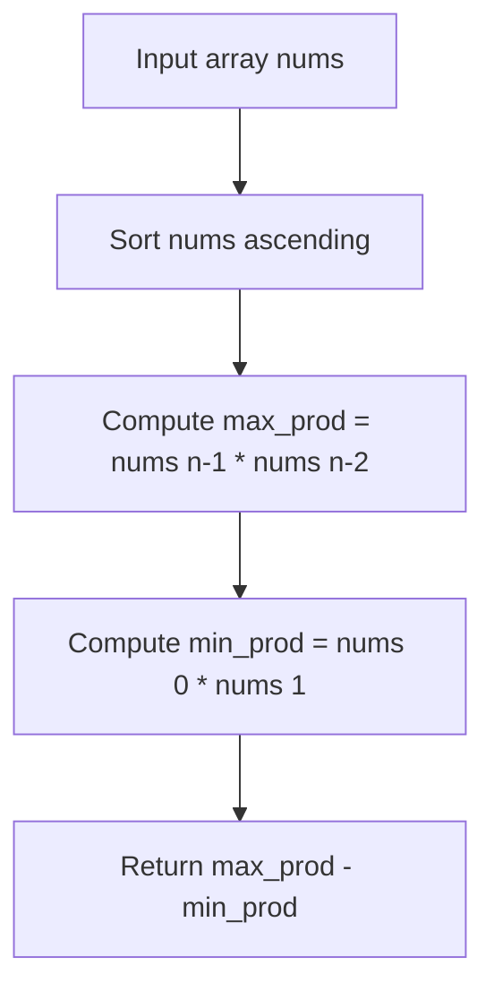

# Maximum Product Difference Between Two Pairs (LeetCode 1913)

## 1. Problem Overview
- **Platform:** LeetCode
- **Problem ID:** [LC-1913](https://leetcode.com/problems/maximum-product-difference-between-two-pairs/)
- **Difficulty / Rating:** Easy
- **Tags:** math, sorting
- **Solution File:** `maximumProductDifferenceBetweenTwoPairs.js`
- **Starter Template:** `templates/leetcode.js`

---

## 2. Core Intuition & Mathematical Rationale
### Key Observations
1. To maximize $(a \cdot b) - (c \cdot d)$, we must choose $a, b$ as the two largest values in the array, and $c, d$ as the two smallest values in the array (since all elements are positive).
2. Sorting the array in ascending order places the smallest two at indices $0$ and $1$, and the largest two at indices $n-2$ and $n-1$.
3. The result is $(nums[n - 1] \cdot nums[n - 2]) - (nums[0] \cdot nums[1])$.

---

## 3. Algorithmic Complexity

| Dimension | Bound | Proof & Rationale |
|---|:---:|---|
| **Time Complexity** | $O(N \log N)$ | Numeric sort over array of length $N$. |
| **Space Complexity** | $O(1)$ auxiliary | In-place sorting. |
| **Recursion Depth** | $O(1)$ | Fully iterative. |
