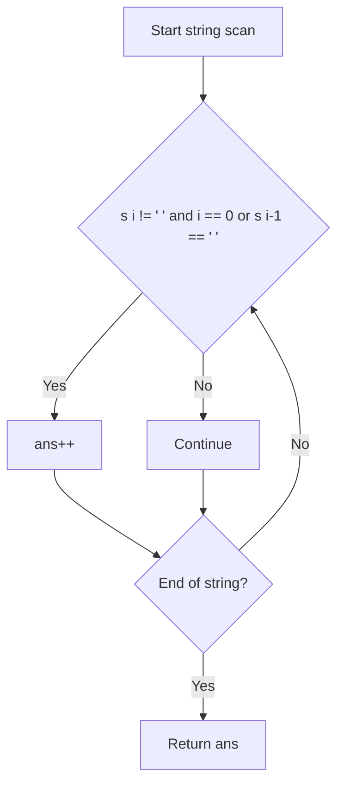

# Number of Segments in a String (LeetCode 434)

## 1. Problem Overview
- **Platform:** LeetCode
- **Problem ID:** [LC-434](https://leetcode.com/problems/number-of-segments-in-a-string/)
- **Difficulty / Rating:** Easy
- **Tags:** strings
- **Solution File:** `numberOfSegmentsInAString.js`
- **Starter Template:** `templates/leetcode.js`

---

## 2. Core Intuition & Mathematical Rationale
### Key Observations
1. A segment is defined as a contiguous sequence of non-space characters.
2. A new segment starts at index $i$ if and only if $s[i] \neq ' '$ and either $i = 0$ or $s[i - 1] = ' '$.
3. A single linear pass counting segment start positions yields the exact segment count in $O(N)$ time and $O(1)$ extra memory.

---

## 3. Algorithmic Complexity

| Dimension | Bound | Proof & Rationale |
|---|:---:|---|
| **Time Complexity** | $O(N)$ | Single linear pass through string of length $N$. |
| **Space Complexity** | $O(1)$ auxiliary | Only integer accumulator used. |
| **Recursion Depth** | $O(1)$ | Fully iterative loop. |
