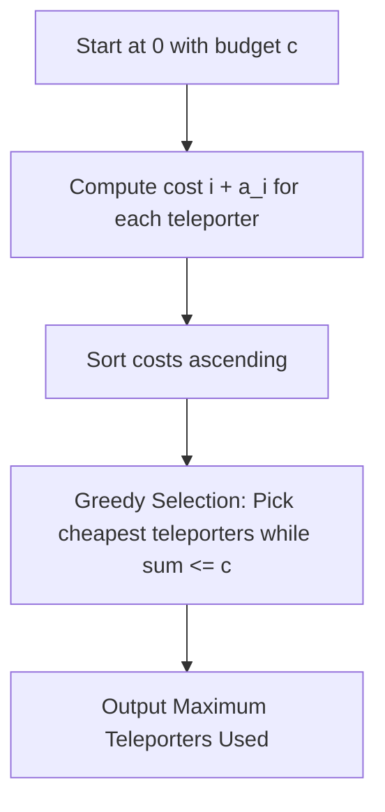

# Teleporters (Easy Version) (Codeforces 1791G1)

## 1. Problem Overview
- **Platform:** Codeforces
- **Problem ID:** [1791G1](https://codeforces.com/problemset/problem/1791/G1)
- **Difficulty / Rating:** 1100
- **Tags:** greedy, sorting
- **Solution File:** `teleportersEasyVersion.js`
- **Starter Template:** `templates/codeforces.js`

---

## 2. Core Intuition & Mathematical Rationale
### Key Observations
1. **Mathematical Invariant:** Moving from $0$ to teleporter $i$ costs $i$ coins. Using teleporter $i$ costs $a_i$ coins and teleports back to $0$. Thus, using teleporter $i$ costs exactly $i + a_i$ coins in total, and resets the player position to point $0$.
2. **Algorithmic Strategy:** Because every teleporter usage returns the position to $0$, choices are independent. To maximize the number of teleporters used with total budget $c$, sort the effective costs $i + a_i$ in ascending order and greedily purchase from the cheapest up to budget $c$.

---

## 3. Algorithmic Complexity

| Dimension | Bound | Proof & Rationale |
|---|:---:|---|
| **Time Complexity** | $O(N \log N)$ | Computing costs takes $O(N)$, sorting takes $O(N \log N)$, greedy scan takes $O(N)$. Total $\sum N \le 2 \cdot 10^5$. |
| **Space Complexity** | $O(N)$ auxiliary | Storing $N$ cost elements. |
| **Recursion Depth** | $O(1)$ | Iterative implementation. |
