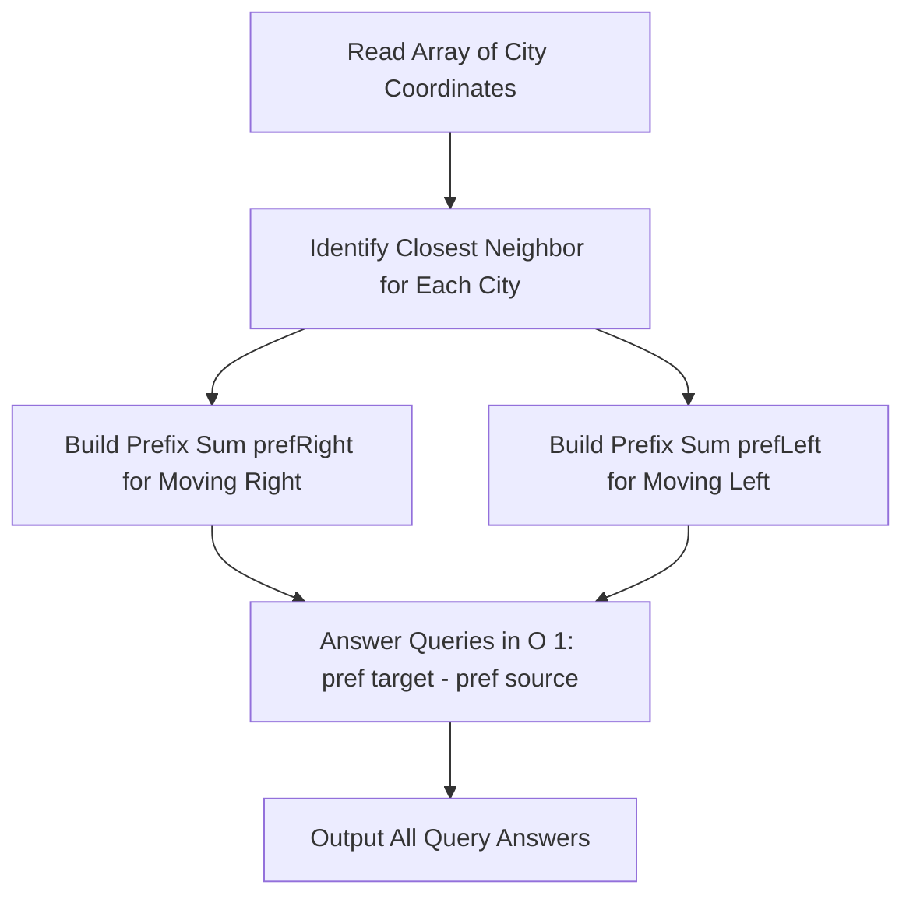

# Closest Cities (Codeforces 1922C)

## 1. Problem Overview
- **Platform:** Codeforces
- **Problem ID:** [1922C](https://codeforces.com/problemset/problem/1922/C)
- **Difficulty / Rating:** 1200
- **Tags:** greedy, prefix sums, math
- **Solution File:** `closestCities.js`
- **Starter Template:** `templates/codeforces.js`

---

## 2. Core Intuition & Mathematical Rationale
### Key Observations
1. **Sorted Geometry:** Coordinates satisfy $a_1 < a_2 < \dots < a_n$. Hence, for any city $i$, the closest city is either its left neighbor $i-1$ or right neighbor $i+1$.
   - City 1 always has city 2 as its closest neighbor.
   - City $n$ always has city $n-1$ as its closest neighbor.
   - For $1 < i < n$, closest neighbor is chosen by comparing $a_i - a_{i-1}$ vs $a_{i+1} - a_i$.
2. **Directional Transition Costs:**
   - Traveling from $i$ to $i+1$ costs 1 if city $i+1$ is closest to $i$; otherwise it costs $a_{i+1} - a_i$.
   - Traveling from $i$ to $i-1$ costs 1 if city $i-1$ is closest to $i$; otherwise it costs $a_i - a_{i-1}$.
3. **Prefix Sum Resolution:**
   - Precompute `prefRight[k]`: total cost from city 1 to city $k$. Query for $s < t$ is answered in $O(1)$ by `prefRight[t] - prefRight[s]`.
   - Precompute `prefLeft[k]`: total cost from city $n$ down to city $k$. Query for $s > t$ is answered in $O(1)$ by `prefLeft[t] - prefLeft[s]`.



---

## 3. Algorithmic Complexity

| Dimension | Bound | Proof & Rationale |
|---|:---:|---|
| **Time Complexity** | $O(N + M)$ | $O(N)$ prefix preprocessing and $O(1)$ per query over $M$ queries. |
| **Space Complexity** | $O(N)$ | `Float64Array` buffers for coordinates and prefix sums. |
| **Numeric Safety** | Plain Number | Sum of distances can reach up to $10^9 \times 10^5 = 10^{14}$, safely stored in JS 64-bit IEEE-754 floats ($9 \cdot 10^{15}$). |

---

## 4. Edge Cases & Boundary Conditions
- **$s = t$:** Distance is 0 (though problem specifies distinct cities).
- **Adjacent Cities:** Direct 1-step queries.
- **Large Coordinates:** Handled without 32-bit integer truncation via `Float64Array`.

---

## 5. Idiomatic Implementation
```javascript
// Reference: solutions/closestCities.js
```
