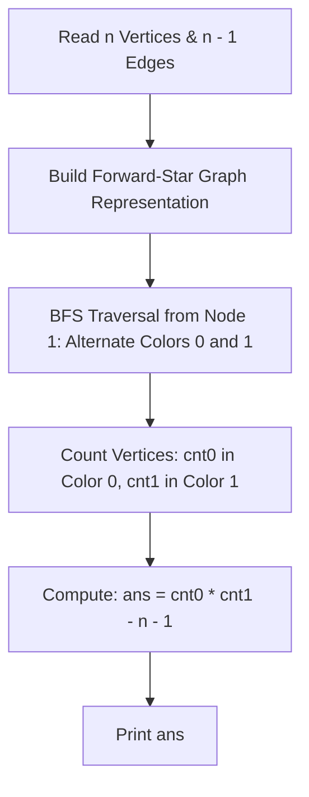

# Mahmoud and Ehab and the bipartiteness (Codeforces 862B)

## 1. Problem Overview
- **Platform:** Codeforces
- **Problem ID:** [862B](https://codeforces.com/problemset/problem/862/B)
- **Difficulty / Rating:** 1200
- **Tags:** dfs and similar, graphs, trees
- **Solution File:** `mahmoudAndEhabAndTheBipartiteness.js`
- **Starter Template:** `templates/codeforces.js`

---

## 2. Core Intuition & Mathematical Rationale
### Key Observations
1. **Tree Bipartite Invariant:** Any tree is a bipartite graph and has a unique 2-coloring (up to swapping the two colors).
2. **Complete Bipartite Graph Capacity:** If the two bipartite color sets have sizes $cnt_0$ and $cnt_1$ (where $cnt_0 + cnt_1 = n$), the maximum number of edges a simple bipartite graph on these sets can have is $cnt_0 \times cnt_1$.
3. **Additional Edges Needed:** The tree already contains $n - 1$ edges connecting vertices between the two sets. Hence, the maximum number of new edges we can add without violating bipartiteness is:
   $$\text{ans} = (cnt_0 \times cnt_1) - (n - 1)$$
4. **Traversal Efficiency:** Using an iterative BFS with flat typed arrays avoids call stack overflow on deep linear trees ($N = 10^5$).



---

## 3. Algorithmic Complexity

| Dimension | Bound | Proof & Rationale |
|---|:---:|---|
| **Time Complexity** | $O(N)$ | BFS visits each vertex and edge exactly once. |
| **Space Complexity** | $O(N)$ | Flat typed arrays (`head`, `to`, `next`, `color`, `queue`). |
| **Numeric Safety** | BigInt / 64-bit | $cnt_0 \times cnt_1$ can reach $(5 \cdot 10^4)^2 = 2.5 \cdot 10^9$, safe with standard 64-bit BigInt math. |

---

## 4. Edge Cases & Boundary Conditions
- **Star Tree:** Center has degree $n - 1$. $cnt_0 = 1, cnt_1 = n - 1 \implies 1 \cdot (n - 1) - (n - 1) = 0$.
- **Line Tree:** Alternating colors. Max edges added.
- **Large $N = 10^5$:** Handled in $< 50$ms without stack recursion.

---

## 5. Idiomatic Implementation
```javascript
// Reference: solutions/mahmoudAndEhabAndTheBipartiteness.js
```
