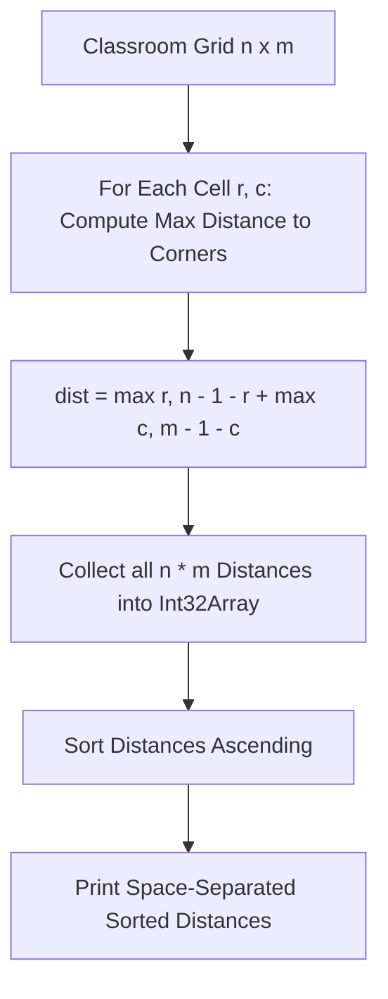

# Not Sitting (Codeforces 1627B)

## 1. Problem Overview
- **Platform:** Codeforces
- **Problem ID:** [1627B](https://codeforces.com/problemset/problem/1627/B)
- **Difficulty / Rating:** 1200
- **Tags:** games, greedy, sortings
- **Solution File:** `notSitting.js`
- **Starter Template:** `templates/codeforces.js`

---

## 2. Core Intuition & Mathematical Rationale
### Key Observations
1. **Game Minimax Dynamic:** Tina wants to maximize the distance from Rahul, while Rahul chooses painted seats to minimize Tina's maximum possible distance.
2. **Corner Dominance:** For any seat $(r, c)$ in the $n \times m$ classroom, the furthest possible seat Tina can choose is always one of the 4 grid corners: $(0, 0)$, $(0, m-1)$, $(n-1, 0)$, or $(n-1, m-1)$.
3. **Furthest Distance Formula:** The maximum Manhattan distance from cell $(r, c)$ to any corner is:
   $$\text{dist}(r, c) = \max(r, n - 1 - r) + \max(c, m - 1 - c)$$
4. **Greedy Elimination:** Rahul will greedily paint seats that yield the largest corner distances first. Thus, sorting the $n \times m$ maximum corner distances in ascending order yields the optimal answers for $k = 0, 1, \dots, n \cdot m - 1$.



---

## 3. Algorithmic Complexity

| Dimension | Bound | Proof & Rationale |
|---|:---:|---|
| **Time Complexity** | $O(NM \log(NM))$ | Dominated by sorting $N \times M$ integers, where $\sum NM \le 10^5$. |
| **Space Complexity** | $O(NM)$ | Flat typed array `Int32Array` of size $NM$. |
| **Numeric Safety** | Plain Number | Max distance $\le 10^5 + 10^5 = 2 \cdot 10^5 \ll 9 \cdot 10^{15}$. |

---

## 4. Edge Cases & Boundary Conditions
- **$1 \times 1$ Grid:** Distance is 0.
- **$1 \times M$ / $N \times 1$ Line:** Degenerates to 1D distances to ends.
- **Symmetric Even Grids ($2 \times 2$):** All cells equidistant to opposite corners.

---

## 5. Idiomatic Implementation
```javascript
// Reference: solutions/notSitting.js
```
