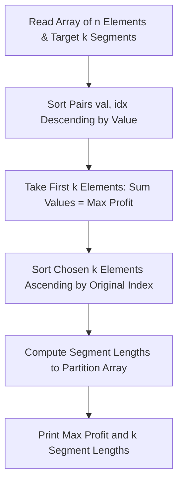

# Polycarp's Practice (Codeforces 1006B)

## 1. Problem Overview
- **Platform:** Codeforces
- **Problem ID:** [1006B](https://codeforces.com/problemset/problem/1006/B)
- **Difficulty / Rating:** 1200
- **Tags:** greedy, sorting, implementation
- **Solution File:** `polycarpSPractice.js`
- **Starter Template:** `templates/codeforces.js`

---

## 2. Core Intuition & Mathematical Rationale
### Key Observations
1. **Upper Bound on Total Profit:** We partition the array into $k$ contiguous segments, and the score is the sum of maximums of each segment. The maximum possible sum cannot exceed the sum of the $k$ largest elements in the entire array.
2. **Achievability:** This theoretical upper bound is always achievable. We simply select the $k$ largest elements with their indices, sort these chosen indices ascending: $p_0 < p_1 < \dots < p_{k-1}$.
3. **Partition Construction:**
   - The first segment ends at $p_0$, having length $p_0 - (-1) = p_0 + 1$.
   - Segment $i$ ($1 \le i < k - 1$) ends at $p_i$, having length $p_i - p_{i-1}$.
   - The last segment ends at the very end of the array, having length $n - 1 - p_{k-2}$.
   - Every segment has length $\ge 1$, their lengths sum to $n$, and each segment contains at least one of the top $k$ elements.



---

## 3. Algorithmic Complexity

| Dimension | Bound | Proof & Rationale |
|---|:---:|---|
| **Time Complexity** | $O(N \log N)$ | Dominated by sorting array of size $N \le 2000$. |
| **Space Complexity** | $O(N)$ | Storing pairs of values and original indices. |
| **Numeric Safety** | Plain Number | Max profit $\le 2000 \times 2000 = 4 \cdot 10^6 \ll 9 \cdot 10^{15}$. |

---

## 4. Edge Cases & Boundary Conditions
- **$k = 1$:** Single segment of length $n$, profit is $\max(a)$.
- **$k = n$:** Each element forms its own segment of length 1.
- **Identical Elements:** Handled gracefully by original index tracking.

---

## 5. Idiomatic Implementation
```javascript
// Reference: solutions/polycarpSPractice.js
```
