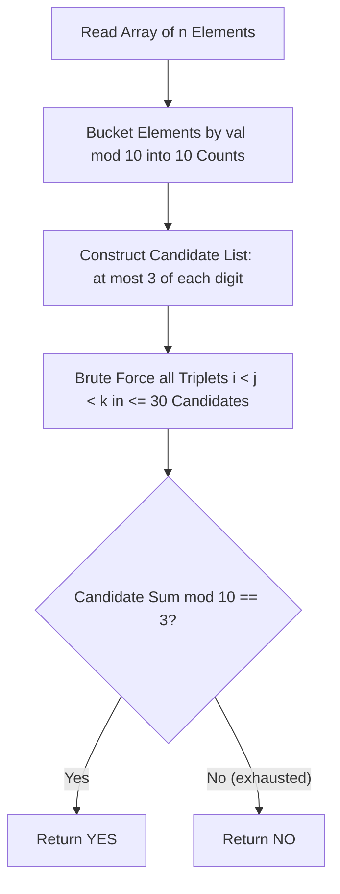

# 3SUM (Codeforces 1692F)

## 1. Problem Overview
- **Platform:** Codeforces
- **Problem ID:** [1692F](https://codeforces.com/problemset/problem/1692/F)
- **Difficulty / Rating:** 1200
- **Tags:** brute force, math
- **Solution File:** `threeSum1692F.js`
- **Starter Template:** `templates/codeforces.js`

---

## 2. Core Intuition & Mathematical Rationale
### Key Observations
1. **Modular Invariant:** The condition $(a_i + a_j + a_k) \pmod{10} === 3$ depends strictly on the last digit of each number $a_i \pmod{10} \in [0, 9]$.
2. **Frequency Pruning (Pigeonhole):** Since we only select a triplet of 3 distinct indices, having more than 3 elements with the same last digit is redundant. Thus, we can safely cap the count of each digit $d \in [0, 9]$ to at most 3.
3. **Bounded Search Space:** The pruned candidate list has length at most $10 \times 3 = 30$. Checking all possible triplets takes at most $\binom{30}{3} = 4060$ iterations, which is $O(1)$ per testcase.



---

## 3. Algorithmic Complexity

| Dimension | Bound | Proof & Rationale |
|---|:---:|---|
| **Time Complexity** | $O(N + \min(N, 30)^3)$ | Counting takes $O(N)$ and triplet enumeration takes at most $4060$ ops ($O(1)$). |
| **Space Complexity** | $O(1)$ auxiliary | Fixed array of size 10 for digit frequencies and candidate list of size $\le 30$. |
| **Numeric Safety** | Plain Number | Sum of 3 digits $\le 27$, trivial standard integers. |

---

## 4. Edge Cases & Boundary Conditions
- **$N = 3$:** Minimal constraint, direct check.
- **All elements ending in same digit:** e.g., three 1s sum to 3 (`1 + 1 + 1 = 3`), correctly detected.
- **No combination possible:** Output NO when no triplet sums to $3 \pmod{10}$.

---

## 5. Idiomatic Implementation
```javascript
// Reference: solutions/threeSum1692F.js
```
