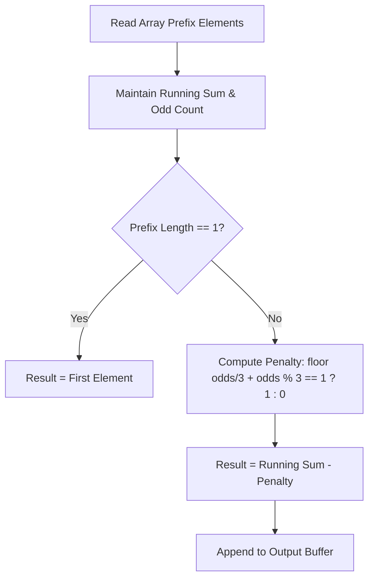

# Training Before the Olympiad (Codeforces 1916C)

## 1. Problem Overview
- **Platform:** Codeforces
- **Problem ID:** [1916C](https://codeforces.com/problemset/problem/1916/C)
- **Difficulty / Rating:** 1200
- **Tags:** greedy, math
- **Solution File:** `trainingBeforeTheOlympiad.js`
- **Starter Template:** `templates/codeforces.js`

---

## 2. Core Intuition & Mathematical Rationale
### Key Observations
1. **Operation Impact on Parity:** When combining two numbers $x$ and $y$ into $\lfloor (x + y)/2 \rfloor \times 2$:
   - If both numbers have the same parity (both even or both odd), $x + y$ is even, so the sum is conserved with 0 loss.
   - If they have opposite parities (one odd, one even), $x + y$ is odd, and the sum decreases by 1.
2. **Turn Dynamics:** Masha plays first (seeking to maximize), and Olya plays second (seeking to minimize). Olya will always try to pair an odd and an even number to force a reduction of 1.
3. **Reduction Count:**
   - Every 3 odd numbers can be resolved such that Olya only forces 1 reduction.
   - If the number of odds leaves remainder 1 modulo 3 (`odds % 3 === 1`), a lone odd number is forced to pair with an even at the end, incurring 1 additional reduction.
   - Penalty for a prefix of length $i > 1$: $\lfloor \text{odds} / 3 \rfloor + (\text{odds} \pmod 3 === 1 ? 1 : 0)$.



---

## 3. Algorithmic Complexity

| Dimension | Bound | Proof & Rationale |
|---|:---:|---|
| **Time Complexity** | $O(N)$ | Single forward pass updating running sum and parity count in $O(1)$ per prefix. |
| **Space Complexity** | $O(N)$ | Array buffer to format output string. |
| **Numeric Safety** | Plain Number | Sum $\le 2 \cdot 10^5 \times 10^9 = 2 \cdot 10^{14}$, safely below $9 \cdot 10^{15}$. |

---

## 4. Edge Cases & Boundary Conditions
- **$N = 1$:** Zero operations possible, output is $a_1$.
- **All Even Array:** $odds = 0$, penalty is 0 for all prefixes.
- **All Odd Array:** Penalty strictly follows $\lfloor \text{odds} / 3 \rfloor + (\text{odds} \pmod 3 === 1 ? 1 : 0)$.

---

## 5. Idiomatic Implementation
```javascript
// Reference: solutions/trainingBeforeTheOlympiad.js
```
