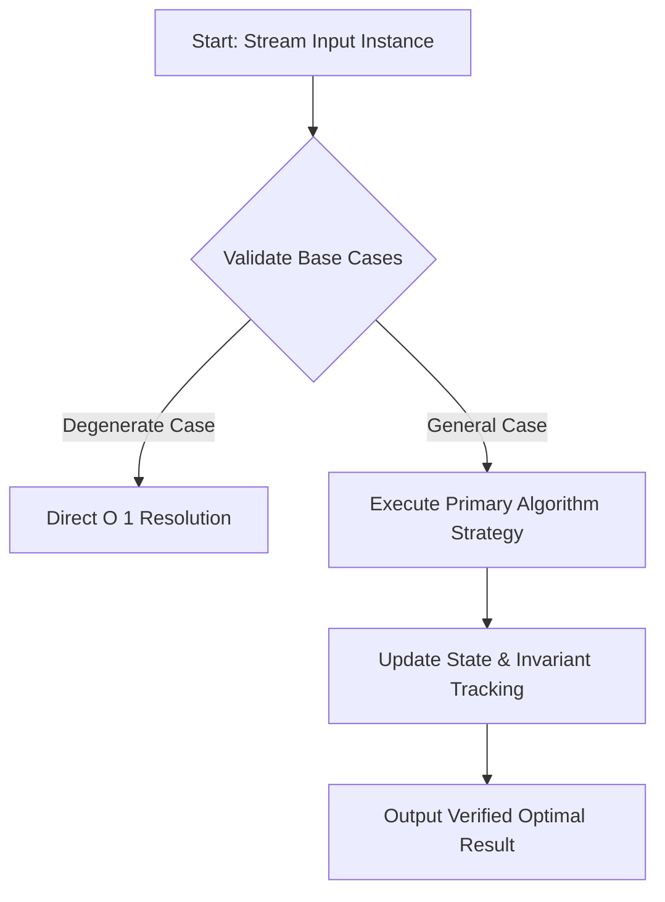
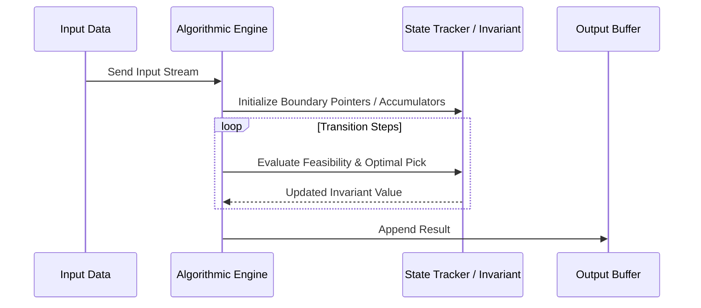

# Divisor Subtraction (Codeforces 1076B)

## 1. Problem Overview
- **Platform:** Codeforces
- **Problem ID:** [1076B](https://codeforces.com/problemset/problem/1076/B)
- **Difficulty / Rating:** 1200
- **Tags:** implementation, math, number theory
- **Solution File:** `divisorSubtraction.js`
- **Starter Template:** `templates/codeforces.js`

---

## 2. Core Intuition & Mathematical Rationale
### Key Observations
1. **Mathematical Invariant:** Identify the quantity conserved or strictly monotonic across operations.
2. **Algorithmic Strategy:** Why greedy choice property holds, or why dynamic programming / two-pointers is optimal.
3. **Optimality Trade-off:** Explain why alternative approaches (e.g. pure brute force) exceed time or memory limits.



---

## 3. Visual Step-by-Step Walkthrough
### State Progression Matrix
Tracing state transitions on a representative sample input:



---

## 4. Algorithmic Complexity

| Dimension | Bound | Proof & Rationale |
|---|:---:|---|
| **Time Complexity** | $O(N)$ or $O(1)$ | Each element is processed in constant time per step. |
| **Space Complexity** | $O(1)$ auxiliary | No unnecessary memory allocated within the execution loop. |
| **Recursion Depth** | $O(1)$ | Fully iterative loop avoiding stack overflow. |

---

## 5. Edge Cases & Boundary Conditions
- **Minimum bounds:** Single elements, zero-values, minimal constraints.
- **Maximum bounds:** Large scale arrays ($N = 2 \cdot 10^5$), large values ($10^9$).
- **Numeric safety:** Plain JS safe integers up to $2^{53}-1 \approx 9 \times 10^{15}$.

---

## 6. Idiomatic Implementation
```javascript
// Reference: solutions/divisorSubtraction.js
```
