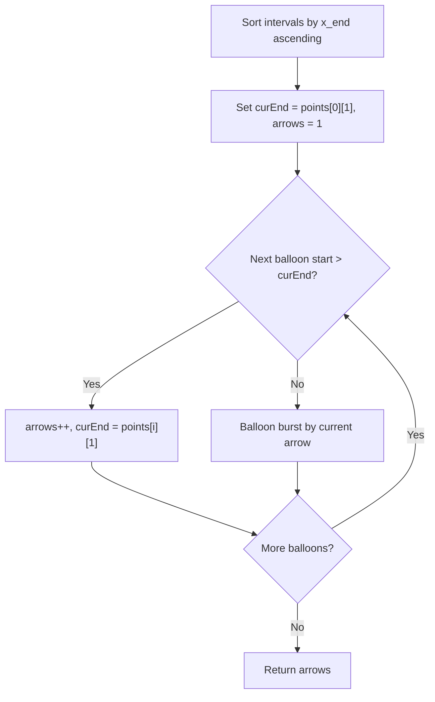

# Minimum Number of Arrows to Burst Balloons (LC-452)

## 1. Problem Overview
Given an array `points` where `points[i] = [x_start, x_end]` represents the horizontal diameter of a spherical balloon, an arrow shot straight up from $x$ bursts all balloons with $x_{start} \le x \le x_{end}$. Find the minimum number of arrows that must be shot to burst all balloons.

## 2. Invariants & Proof
Sort balloons by ending coordinate $x_{end}$ ascending:
- To burst the balloon that ends earliest, any arrow must be shot at $\le x_{end}$.
- Greedily shooting the arrow at exactly $x_{end}$ maximizes the chance of bursting subsequent balloons that start at $\le x_{end}$.
- If a subsequent balloon starts after the current arrow position ($x_{start} > curEnd$), a new arrow is strictly required.

## 3. Complexity
- **Time Complexity:** $O(N \log N)$ to sort $N$ intervals.
- **Space Complexity:** $O(1)$ auxiliary space.

## 4. Mermaid Diagram

