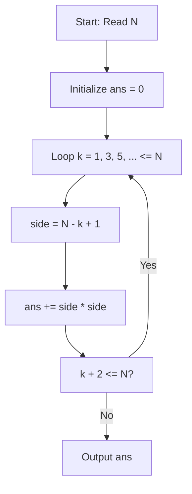

# Chef and Bored Games (CodeChef CC-PCJ18B)

## 1. Problem Overview
- **Platform:** CodeChef
- **Problem ID:** [CC-PCJ18B](https://www.codechef.com/problems/PCJ18B)
- **Difficulty / Rating:** 1402
- **Tags:** codechef, math, combinatorics
- **Solution File:** `chefAndBoredGames.js`
- **Starter Template:** `templates/codechef.js`

---

## 2. Core Intuition & Mathematical Rationale
On a generic $N \times N$ chessboard, a square with side length $k$ has $(N - k + 1)$ valid top-left row coordinates and $(N - k + 1)$ valid column coordinates.
Hence, exactly $(N - k + 1)^2$ squares of size $k \times k$ exist on the board.
Summing this quantity across all odd side lengths $k \in \{1, 3, 5, \dots \le N\}$ produces the total count of odd-sized squares.



---

## 3. Algorithmic Complexity

| Dimension | Bound | Proof & Rationale |
|---|:---:|---|
| **Time Complexity** | $O(N)$ | $\lfloor (N+1)/2 \rfloor$ loop iterations per test case. |
| **Space Complexity** | $O(1)$ | Direct scalar accumulator. |
| **Recursion Depth** | $O(1)$ | Fully iterative execution. |

---

## 4. Idiomatic Implementation
```javascript
// Reference: solutions/chefAndBoredGames.js
```
