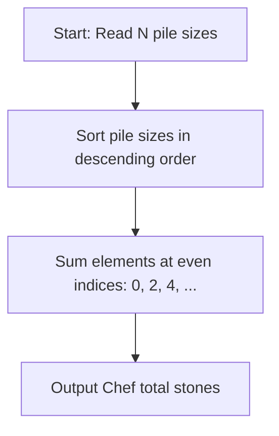

# Chef and easy problem (CodeChef CC-CHEFA)

## 1. Problem Overview
- **Platform:** CodeChef
- **Problem ID:** [CC-CHEFA](https://www.codechef.com/problems/CHEFA)
- **Difficulty / Rating:** 1408
- **Tags:** codechef, greedy, game theory, sorting
- **Solution File:** `chefAndEasyProblem.js`
- **Starter Template:** `templates/codechef.js`

---

## 2. Core Intuition & Mathematical Rationale
There are $N$ piles of stones. In each turn, a player removes any one pile. Both players aim to maximize their total stones removed, and Chef moves first.
Because each player's utility is strictly increasing in the size of the pile taken, both players will greedily select the largest remaining pile on their turn.
Sorting the pile sizes in descending order $a_1 \ge a_2 \ge \dots \ge a_N$, Chef receives the piles at alternate positions (indices 0, 2, 4, ...). The maximum stones Chef collects is:
$$\sum_{i = 0, 2, 4, \dots} a_i$$



---

## 3. Algorithmic Complexity

| Dimension | Bound | Proof & Rationale |
|---|:---:|---|
| **Time Complexity** | $O(N \log N)$ | Numeric sort of $N$ pile sizes per testcase. |
| **Space Complexity** | $O(N)$ | Typed Float64Array storing pile counts. |
| **Recursion Depth** | $O(1)$ | Fully iterative execution. |

---

## 4. Idiomatic Implementation
```javascript
// Reference: solutions/chefAndEasyProblem.js
```
