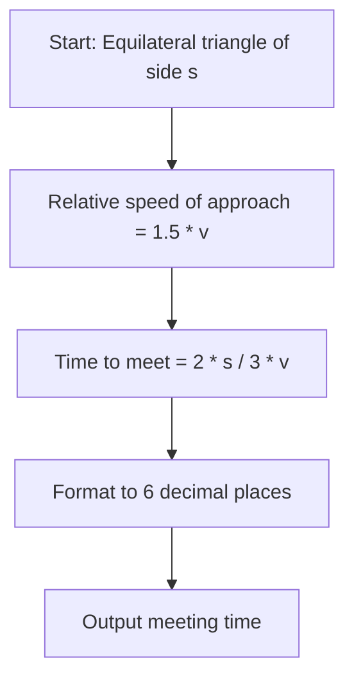

# Chef and Three Dogs (CodeChef CC-CHDOGS)

## 1. Problem Overview
- **Platform:** CodeChef
- **Problem ID:** [CC-CHDOGS](https://www.codechef.com/problems/CHDOGS)
- **Difficulty / Rating:** 1473
- **Tags:** codechef, math, geometry, physics
- **Solution File:** `chefAndThreeDogs.js`
- **Starter Template:** `templates/codechef.js`

---

## 2. Core Intuition & Mathematical Rationale
Three dogs start at the vertices of an equilateral triangle of side $s$, running towards each other with constant speed $v$ in cyclic pursuit.
By symmetry, the dogs form a shrinking equilateral triangle at every instant $t$.
The relative velocity at which the distance $r$ between any two adjacent dogs decreases is:
$$-\frac{dr}{dt} = v + v \cos(60^\circ) = v + \frac{1}{2}v = \frac{3}{2}v$$
Since this relative speed of approach is constant, the time until they meet at the centroid is:
$$t = \frac{s}{\frac{3}{2}v} = \frac{2s}{3v}$$



---

## 3. Algorithmic Complexity

| Dimension | Bound | Proof & Rationale |
|---|:---:|---|
| **Time Complexity** | $O(1)$ | Direct closed-form formula evaluation per test case. |
| **Space Complexity** | $O(1)$ | No memory allocated. |
| **Recursion Depth** | $O(1)$ | Fully iterative execution. |

---

## 4. Idiomatic Implementation
```javascript
// Reference: solutions/chefAndThreeDogs.js
```
