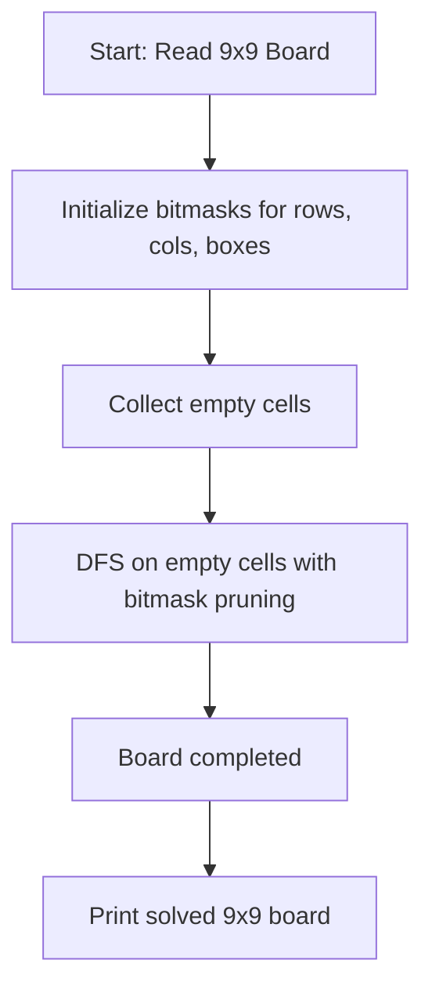

# Chef Solves Sudoku (CodeChef CC-UELPQ01)

## 1. Problem Overview
- **Platform:** CodeChef
- **Problem ID:** [CC-UELPQ01](https://www.codechef.com/problems/UELPQ01)
- **Difficulty / Rating:** 1450
- **Tags:** codechef, backtracking, bitmasks
- **Solution File:** `chefSolvesSudoku.js`
- **Starter Template:** `templates/codechef.js`

---

## 2. Core Intuition & Mathematical Rationale
The problem requires completing a standard $9 \times 9$ Sudoku board.
We maintain bitmasks of size 9 for:
- `rowMask[r]`: bit $k$ set if digit $k$ is present in row $r$.
- `colMask[c]`: bit $k$ set if digit $k$ is present in column $c$.
- `boxMask[b]`: bit $k$ set if digit $k$ is present in $3 \times 3$ subgrid $b$.

By combining `rowMask[r] | colMask[c] | boxMask[b]`, valid candidates for cell $(r, c)$ are tested via recursive backtracking with early exit on completion.



---

## 3. Algorithmic Complexity

| Dimension | Bound | Proof & Rationale |
|---|:---:|---|
| **Time Complexity** | $O(9^m)$ worst case, practically $O(1)$ | Pruning via bitmasks solves valid boards in $< 1$ms. |
| **Space Complexity** | $O(1)$ auxiliary | Fixed $9 \times 9$ board and size 9 bitmask arrays. |
| **Recursion Depth** | $\le 81$ | At most 81 cells on the recursion stack. |

---

## 4. Idiomatic Implementation
```javascript
// Reference: solutions/chefSolvesSudoku.js
```
