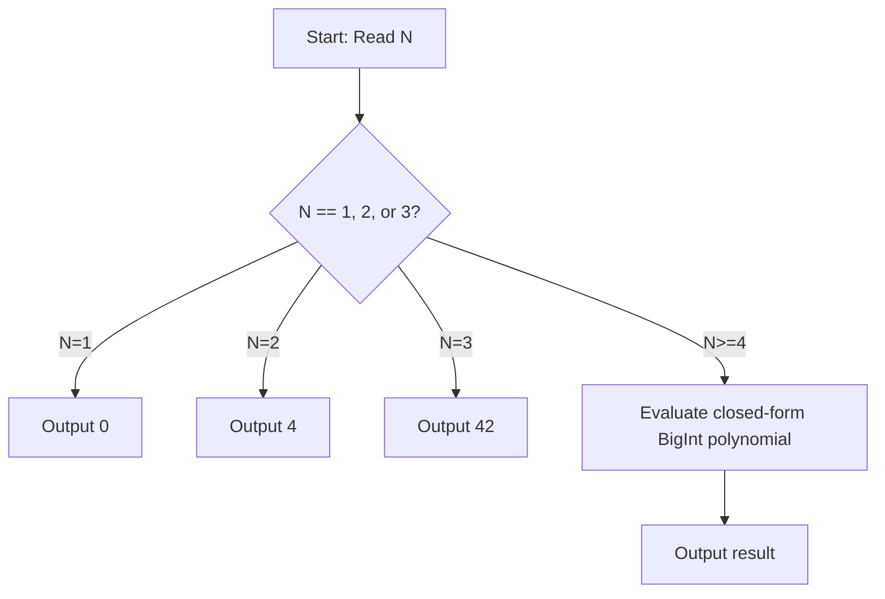

# Counting Flags (CodeChef CC-FLAGS)

## 1. Problem Overview
- **Platform:** CodeChef
- **Problem ID:** [CC-FLAGS](https://www.codechef.com/problems/FLAGS)
- **Difficulty / Rating:** 1446
- **Tags:** codechef, math, combinatorics
- **Solution File:** `countingFlags.js`
- **Starter Template:** `templates/codechef.js`

---

## 2. Core Intuition & Mathematical Rationale
The problem counts the total number of well-painted flags using $N$ colors across 5 structural patterns:
- Pattern 1 & 2: 3 stripes (vertical or horizontal) where adjacent stripes differ: $2 \times N(N-1)^2$.
- Pattern 3: 3 mutually adjacent regions: $2 \times N(N-1)(N-2)$.
- Pattern 4: 4 regions (quarters/cross): yields polynomial terms in $N(N-1)(N-2)$ and $N(N-1)(N-2)(N-3)$.
- Pattern 5: 4-part flags with specified border constraints.

Summing all valid colorings across the 5 blueprints yields the simplified closed-form polynomial:
$$F(N) = 2N(N-1) + 5N(N-1)(N-2) + 2N(N-1)(N-2)(N-3)$$
Evaluating this polynomial using `BigInt` gives the exact answer for all $N \ge 1$:
- $F(1) = 0$
- $F(2) = 4$
- $F(3) = 42$
- $F(N)$ for $N \ge 4$ computed in $O(1)$ operations.



---

## 3. Algorithmic Complexity

| Dimension | Bound | Proof & Rationale |
|---|:---:|---|
| **Time Complexity** | $O(1)$ | Direct polynomial arithmetic per testcase. |
| **Space Complexity** | $O(1)$ | BigInt arithmetic variables. |
| **Recursion Depth** | $O(1)$ | Fully iterative execution. |

---

## 4. Idiomatic Implementation
```javascript
// Reference: solutions/countingFlags.js
```
