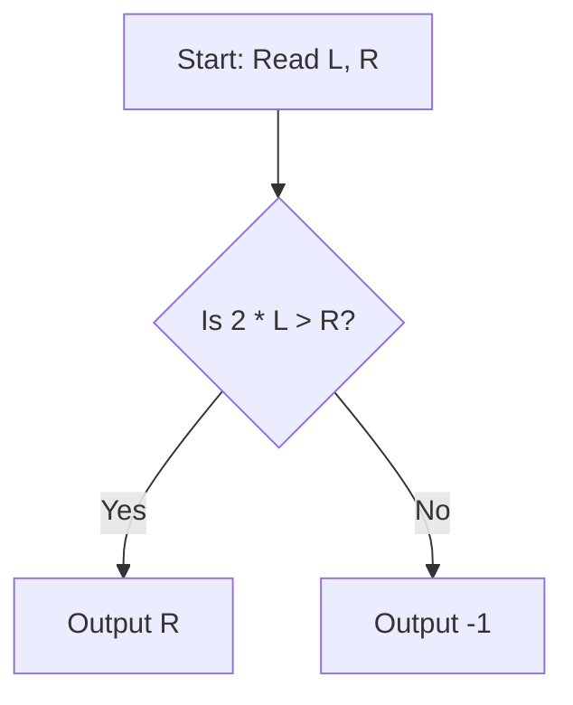

# Decreasing Srrnmieeda (CodeChef CC-DECREM)

## 1. Problem Overview
- **Platform:** CodeChef
- **Problem ID:** [CC-DECREM](https://www.codechef.com/problems/DECREM)
- **Difficulty / Rating:** 1423
- **Tags:** codechef, math, number theory
- **Solution File:** `decreasingSrrnmieeda.js`
- **Starter Template:** `templates/codechef.js`

---

## 2. Core Intuition & Mathematical Rationale
We seek the smallest non-negative integer $N$ such that $N \% k$ strictly decreases as $k$ ranges from $L$ to $R$.
- For any $N < R$, $N \% R = N$. But for any $k$, $N \% k \le N$, making a strictly decreasing chain impossible. Thus $N \ge R$.
- When $2L > R$, choosing $N = R$ gives $R \% k = R - k$ for all $k \in [L, R]$ since $\lfloor R/k \rfloor = 1$. This is strictly decreasing from $R - L$ down to $0$. Thus $R$ is the minimal valid answer.
- If $2L \le R$, then both $L$ and $2L$ lie in the interval $[L, R]$. For any $N$, $N \% (2L) \ge N \% L$, contradicting strict decrease. Hence no valid $N$ exists, and the answer is $-1$.



---

## 3. Algorithmic Complexity

| Dimension | Bound | Proof & Rationale |
|---|:---:|---|
| **Time Complexity** | $O(1)$ | Direct closed-form inequality test per test case. |
| **Space Complexity** | $O(1)$ | No memory allocated. |
| **Recursion Depth** | $O(1)$ | Fully iterative execution. |

---

## 4. Idiomatic Implementation
```javascript
// Reference: solutions/decreasingSrrnmieeda.js
```
