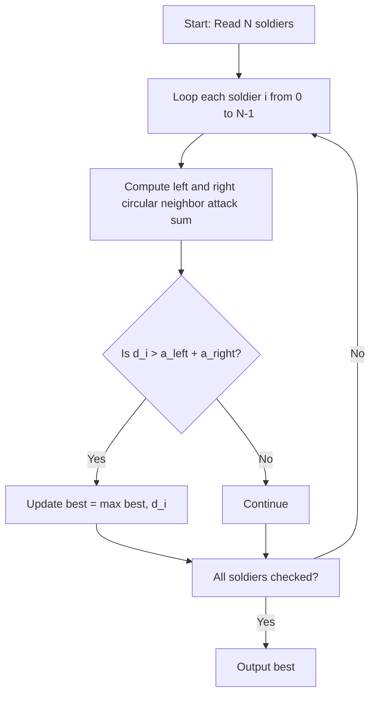

# Deputy Chef (CodeChef CC-DEPCHEF)

## 1. Problem Overview
- **Platform:** CodeChef
- **Problem ID:** [CC-DEPCHEF](https://www.codechef.com/problems/DEPCHEF)
- **Difficulty / Rating:** 1397
- **Tags:** codechef, greedy, arrays
- **Solution File:** `deputyChef.js`
- **Starter Template:** `templates/codechef.js`

---

## 2. Core Intuition & Mathematical Rationale
In a circular formation of $N$ soldiers, soldier $i$ (0-indexed) has neighbors $(i-1+N)\%N$ and $(i+1)\%N$.
The incoming attack on soldier $i$ is $a_{left} + a_{right}$.
Soldier $i$ survives if and only if $d_i > a_{left} + a_{right}$.
Chef selects the surviving soldier with maximum $d_i$, or $-1$ if none survive.



---

## 3. Algorithmic Complexity

| Dimension | Bound | Proof & Rationale |
|---|:---:|---|
| **Time Complexity** | $O(N)$ | Linear single pass over $N$ soldiers per test case. |
| **Space Complexity** | $O(N)$ | Typed arrays for attack and defense values. |
| **Recursion Depth** | $O(1)$ | Fully iterative execution. |

---

## 4. Idiomatic Implementation
```javascript
// Reference: solutions/deputyChef.js
```
