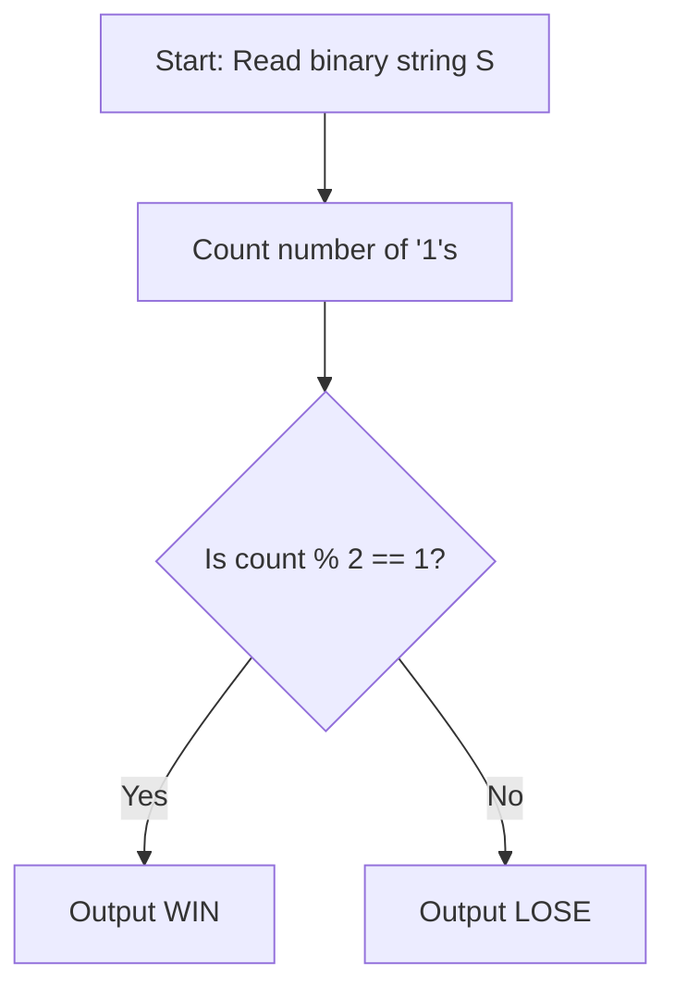

# Dilemma (CodeChef CC-CHEFDIL)

## 1. Problem Overview
- **Platform:** CodeChef
- **Problem ID:** [CC-CHEFDIL](https://www.codechef.com/problems/CHEFDIL)
- **Difficulty / Rating:** 1461
- **Tags:** codechef, math, game theory, invariants
- **Solution File:** `dilemma.js`
- **Starter Template:** `templates/codechef.js`

---

## 2. Core Intuition & Mathematical Rationale
In this card-clearing game, only face-up cards (`'1'`) can be removed, and doing so flips both adjacent cards.
Consider the total number of `'1'`s modulo 2:
- Removing a `'1'` card changes its value from 1 to 0 (a change of $-1$).
- Flipping each adjacent card changes its state by $\pm 1$.
- For an interior card, two neighbors flip; the net change in the sum of `'1'`s is $-1 + (\pm 1) + (\pm 1)$, which is always odd.
- For a boundary card, one neighbor flips; the net change is $-1 + (\pm 1)$, which is even. However, boundary cards reduce the board size.
Across all valid reduction paths, the invariant parity of `'1'`s dictates that the table can be cleared completely down to 0 cards if and only if the starting count of `'1'`s is odd (`WIN`), otherwise `LOSE`.



---

## 3. Algorithmic Complexity

| Dimension | Bound | Proof & Rationale |
|---|:---:|---|
| **Time Complexity** | $O(N)$ | Single linear pass over string $S$ per testcase. |
| **Space Complexity** | $O(1)$ | Scalar counter. |
| **Recursion Depth** | $O(1)$ | Fully iterative execution. |

---

## 4. Idiomatic Implementation
```javascript
// Reference: solutions/dilemma.js
```
