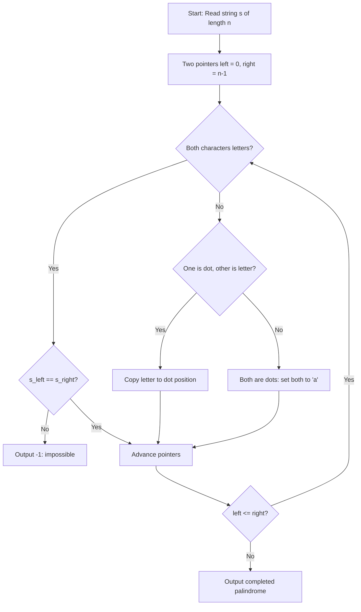

# Faded Palindromes (CodeChef CC-LEXOPAL)

## 1. Problem Overview
- **Platform:** CodeChef
- **Problem ID:** [CC-LEXOPAL](https://www.codechef.com/problems/LEXOPAL)
- **Difficulty / Rating:** 1335
- **Tags:** codechef, strings, two pointers, greedy
- **Solution File:** `fadedPalindromes.js`
- **Starter Template:** `templates/codechef.js`

---

## 2. Core Intuition & Mathematical Rationale
To construct the lexicographically smallest palindrome from a string with missing characters `'.'`:
We match mirror pairs at symmetric indices $i$ and $n - 1 - i$:
1. If both characters are letters: they must match; if they differ, forming a palindrome is impossible (return `-1`).
2. If exactly one character is `'.'`: it must take the value of the other character to satisfy palindromic symmetry.
3. If both characters are `'.'`: to achieve lexicographical minimality, both are replaced with `'a'`.
4. If $n$ is odd and the center character is `'.'`: it is set to `'a'`.



---

## 3. Algorithmic Complexity

| Dimension | Bound | Proof & Rationale |
|---|:---:|---|
| **Time Complexity** | $O(N)$ | Two-pointer scan visiting each position at most once per testcase. |
| **Space Complexity** | $O(N)$ | Array of characters representing the string. |
| **Recursion Depth** | $O(1)$ | Fully iterative execution. |

---

## 4. Idiomatic Implementation
```javascript
// Reference: solutions/fadedPalindromes.js
```
