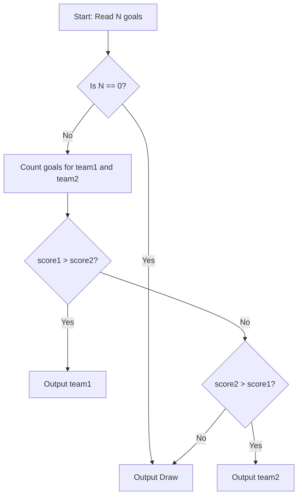

# Football Match (CodeChef CC-FBMT)

## 1. Problem Overview
- **Platform:** CodeChef
- **Problem ID:** [CC-FBMT](https://www.codechef.com/problems/FBMT)
- **Difficulty / Rating:** 1379
- **Tags:** codechef, strings, implementation
- **Solution File:** `footballMatch.js`
- **Starter Template:** `templates/codechef.js`

---

## 2. Core Intuition & Mathematical Rationale
The score log contains $N$ goal records. We track the two competing team names and tally their goal counts.
If $N=0$ or both scores are equal, the result is `Draw`.
Otherwise, the team with strictly greater score is printed.



---

## 3. Algorithmic Complexity

| Dimension | Bound | Proof & Rationale |
|---|:---:|---|
| **Time Complexity** | $O(N)$ | Single pass over $N$ goal entries per test case. |
| **Space Complexity** | $O(1)$ | Constant variables for team identifiers and integer counters. |
| **Recursion Depth** | $O(1)$ | Iterative loop. |

---

## 4. Idiomatic Implementation
```javascript
// Reference: solutions/footballMatch.js
```
