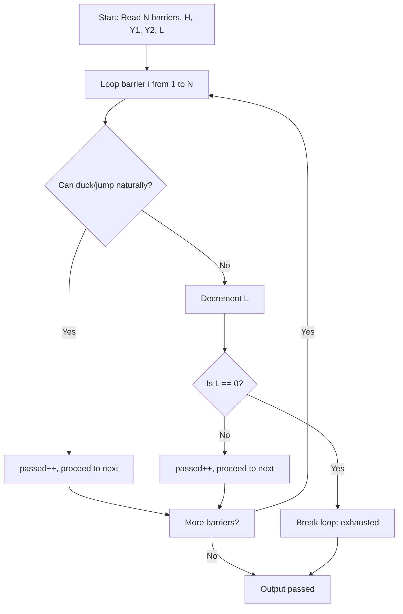

# Full Barrier Alchemist (CodeChef CC-PIPSQUIK)

## 1. Problem Overview
- **Platform:** CodeChef
- **Problem ID:** [CC-PIPSQUIK](https://www.codechef.com/problems/PIPSQUIK)
- **Difficulty / Rating:** 1426
- **Tags:** codechef, simulation, greedy
- **Solution File:** `fullBarrierAlchemist.js`
- **Starter Template:** `templates/codechef.js`

---

## 2. Core Intuition & Mathematical Rationale
Edward moves past a series of $N$ barriers in sequential order.
- **Type 1 barrier:** Clearance is underneath. Ducking reduces Edward's effective height to $H - Y_1$. He clears it without alchemy if $H - Y_1 \le X$.
- **Type 2 barrier:** Barrier extends from the ground. Edward jumps by height $Y_2$. He clears it without alchemy if $Y_2 \ge X$.
- **Alchemy:** If neither condition is met, breaking costs 1 unit of life force ($L \leftarrow L - 1$). If $L = 0$ after decrement, he is exhausted and fails to cross that barrier, terminating the traversal immediately.



---

## 3. Algorithmic Complexity

| Dimension | Bound | Proof & Rationale |
|---|:---:|---|
| **Time Complexity** | $O(N)$ | Single sequential simulation pass over $N$ barriers. |
| **Space Complexity** | $O(1)$ | Constant state variables. |
| **Recursion Depth** | $O(1)$ | Fully iterative execution. |

---

## 4. Idiomatic Implementation
```javascript
// Reference: solutions/fullBarrierAlchemist.js
```
