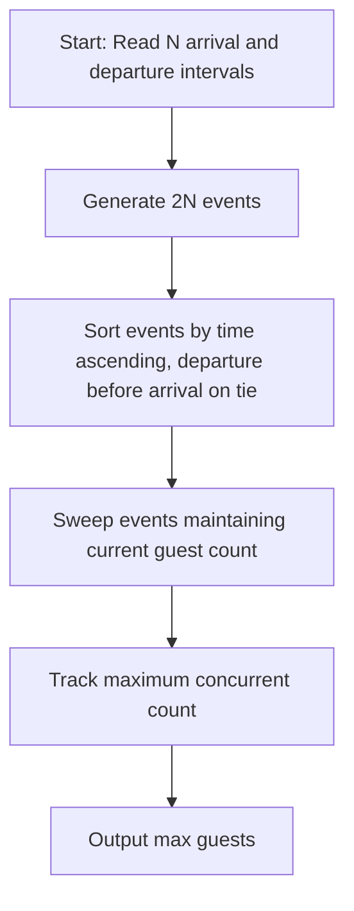

# Hotel Bytelandia (CodeChef CC-HOTEL)

## 1. Problem Overview
- **Platform:** CodeChef
- **Problem ID:** [CC-HOTEL](https://www.codechef.com/problems/HOTEL)
- **Difficulty / Rating:** 1405
- **Tags:** codechef, greedy, sorting, two pointers
- **Solution File:** `hotelBytelandia.js`
- **Starter Template:** `templates/codechef.js`

---

## 2. Core Intuition & Mathematical Rationale
Each guest has an arrival time and a departure time.
When a departure and arrival coincide at the same time $t$, they are not counted simultaneously.
Therefore, we treat departures as occurring strictly before arrivals at the same timestamp.
By representing each event as a coordinate pair $(time, type)$ where departure has lower tie-break priority than arrival, sorting all $2N$ events and sweeping across time with a counter yields the peak concurrent occupancy.



---

## 3. Algorithmic Complexity

| Dimension | Bound | Proof & Rationale |
|---|:---:|---|
| **Time Complexity** | $O(N \log N)$ | Sorting $2N$ events per test case dominates. |
| **Space Complexity** | $O(N)$ | Array of $2N$ encoded events. |
| **Recursion Depth** | $O(1)$ | Fully iterative execution. |

---

## 4. Idiomatic Implementation
```javascript
// Reference: solutions/hotelBytelandia.js
```
