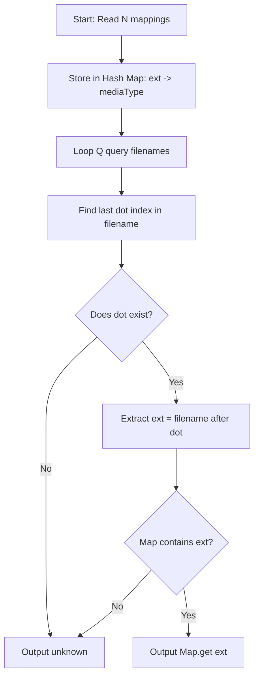

# Internet Media Types (CodeChef CC-MIME2)

## 1. Problem Overview
- **Platform:** CodeChef
- **Problem ID:** [CC-MIME2](https://www.codechef.com/problems/MIME2)
- **Difficulty / Rating:** 1362
- **Tags:** codechef, strings, hash table
- **Solution File:** `internetMediaTypes.js`
- **Starter Template:** `templates/codechef.js`

---

## 2. Core Intuition & Mathematical Rationale
We are provided $N$ mapping pairs from file extensions to media types.
For each of the $Q$ query filenames:
- We identify the final period `.` using `lastIndexOf('.')`.
- If no dot exists, the file has no extension $\implies$ `unknown`.
- Otherwise, the case-sensitive substring after the final dot is extracted and looked up in the hash map.
- If the extension key exists in the map, its value is printed; otherwise, `unknown` is emitted.



---

## 3. Algorithmic Complexity

| Dimension | Bound | Proof & Rationale |
|---|:---:|---|
| **Time Complexity** | $O(N \cdot L + Q \cdot L)$ | Linear string parsing and $O(1)$ average hash table lookups for strings of length $L$. |
| **Space Complexity** | $O(N \cdot L)$ | Storage for $N$ mapping associations in a JavaScript Map. |
| **Recursion Depth** | $O(1)$ | Fully iterative execution. |

---

## 4. Idiomatic Implementation
```javascript
// Reference: solutions/internetMediaTypes.js
```
