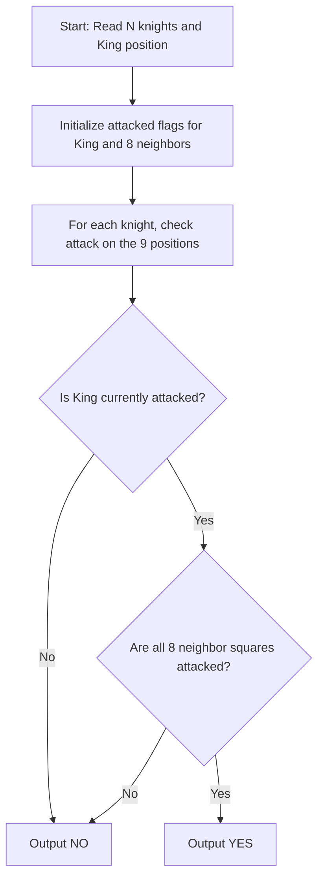

# Knight Chess (CodeChef CC-KCHESS)

## 1. Problem Overview
- **Platform:** CodeChef
- **Problem ID:** [CC-KCHESS](https://www.codechef.com/problems/KCHESS)
- **Difficulty / Rating:** 1420
- **Tags:** codechef, geometry, chess, simulation
- **Solution File:** `knightChess.js`
- **Starter Template:** `templates/codechef.js`

---

## 2. Core Intuition & Mathematical Rationale
The white king is in checkmate if and only if:
1. The king is currently in check (attacked by at least one knight).
2. All 8 neighboring positions of the king are also attacked by at least one knight.

Instead of hashing all attacked positions on an infinite board, we only track the threat status of 9 fixed locations:
- The king's current position $(A, B)$
- The 8 adjacent squares $(A + dx, B + dy)$ for $dx, dy \in \{-1, 0, 1\}, (dx, dy) \ne (0, 0)$.

Each of the $N$ knights checks attack viability on these 9 positions in $O(1)$ time, yielding an optimal $O(N)$ solution with $O(1)$ auxiliary space.



---

## 3. Algorithmic Complexity

| Dimension | Bound | Proof & Rationale |
|---|:---:|---|
| **Time Complexity** | $O(N)$ | $9 \times N$ constant arithmetic checks per testcase. |
| **Space Complexity** | $O(N)$ | Typed arrays for knight coordinates. |
| **Recursion Depth** | $O(1)$ | Fully iterative execution. |

---

## 4. Idiomatic Implementation
```javascript
// Reference: solutions/knightChess.js
```
