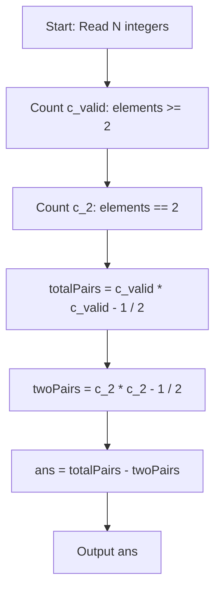

# Little Chef and Numbers (CodeChef CC-PROSUM)

## 1. Problem Overview
- **Platform:** CodeChef
- **Problem ID:** [CC-PROSUM](https://www.codechef.com/problems/PROSUM)
- **Difficulty / Rating:** 1490
- **Tags:** codechef, math, combinatorics
- **Solution File:** `littleChefAndNumbers.js`
- **Starter Template:** `templates/codechef.js`

---

## 2. Core Intuition & Mathematical Rationale
We seek the number of pairs $(i, j)$ with $i < j$ satisfying $A_i \cdot A_j > A_i + A_j$:
- If either element is $0$, $0 > A_j$ is impossible.
- If either element is $1$, $A_j > 1 + A_j$ is impossible.
- If both elements equal $2$, $2 \cdot 2 = 4 \ngtr 2 + 2 = 4$.
- For all other pairs where both elements are $\ge 2$ with at least one element $\ge 3$, the inequality strictly holds.
Thus, the total valid pairs equals all pairs formed from elements $\ge 2$ minus the pairs where both elements are equal to $2$:
$$\binom{c_{valid}}{2} - \binom{c_2}{2}$$



---

## 3. Algorithmic Complexity

| Dimension | Bound | Proof & Rationale |
|---|:---:|---|
| **Time Complexity** | $O(N)$ | Single linear scan of $N$ array elements per testcase. |
| **Space Complexity** | $O(1)$ | Counter variables only. |
| **Recursion Depth** | $O(1)$ | Fully iterative execution. |

---

## 4. Idiomatic Implementation
```javascript
// Reference: solutions/littleChefAndNumbers.js
```
