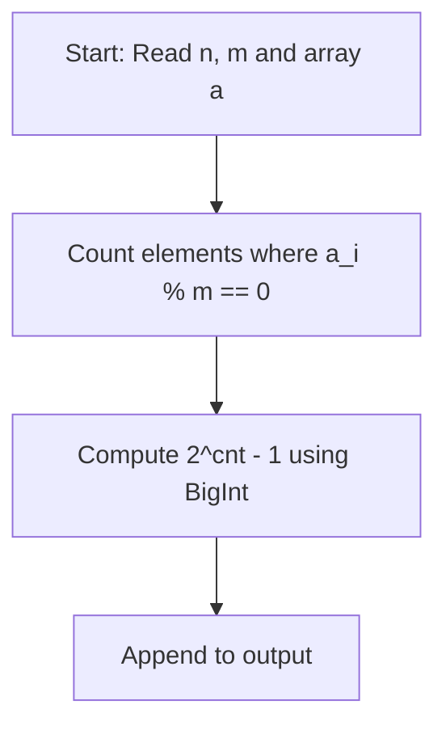

# Magic Set (CodeChef CC-MGCSET)

## 1. Problem Overview
- **Platform:** CodeChef
- **Problem ID:** [CC-MGCSET](https://www.codechef.com/problems/MGCSET)
- **Difficulty / Rating:** 1472
- **Tags:** codechef, math, modular arithmetic
- **Solution File:** `magicSet.js`
- **Starter Template:** `templates/codechef.js`

---

## 2. Core Intuition & Mathematical Rationale
A subsequence is good if every one of its non-empty subsequences has a sum divisible by $m$.
If an element $x$ is not divisible by $m$, the single-element subsequence $[x]$ has sum $x \not\equiv 0 \pmod m$.
Thus, every element chosen must be a multiple of $m$.
Conversely, if every element is a multiple of $m$, any non-empty sum of multiples of $m$ is also a multiple of $m$.
If $cnt$ elements are divisible by $m$, any non-empty subset of them is valid, giving $2^{cnt} - 1$ good subsequences.



---

## 3. Algorithmic Complexity

| Dimension | Bound | Proof & Rationale |
|---|:---:|---|
| **Time Complexity** | $O(N)$ | Single pass over the array per test case. |
| **Space Complexity** | $O(1)$ auxiliary | Counter variable only. |
| **Recursion Depth** | $O(1)$ | Fully iterative execution. |

---

## 4. Idiomatic Implementation
```javascript
// Reference: solutions/magicSet.js
```
