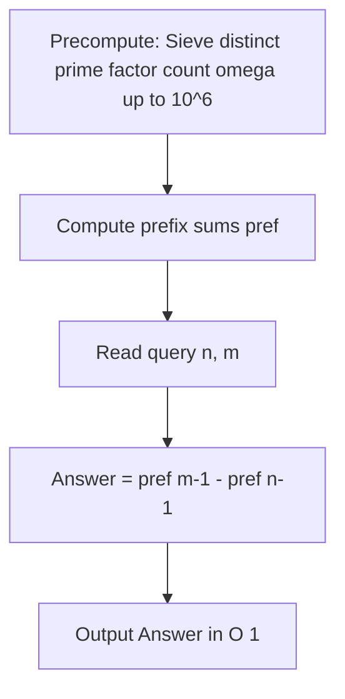

# Majin Vegeta (CodeChef CC-VEGETA)

## 1. Problem Overview
- **Platform:** CodeChef
- **Problem ID:** [CC-VEGETA](https://www.codechef.com/problems/VEGETA)
- **Difficulty / Rating:** 1477
- **Tags:** codechef, math, number theory, prime sieve
- **Solution File:** `majinVegeta.js`
- **Starter Template:** `templates/codechef.js`

---

## 2. Core Intuition & Mathematical Rationale
Vegeta steps from level $n$ up to level $m$. For each unit step from $i$ to $i+1$, the energy expended equals $\omega(i)$, the number of distinct prime factors of $i$.
The total energy required is:
$$\sum_{i=n}^{m-1} \omega(i)$$
We precompute $\omega(i)$ for all integers up to $10^6$ using an adapted Eratosthenes sieve in $O(M \log \log M)$ time, where $M = 10^6$.
Building a prefix sum array `pref[x] = pref[x-1] + omega[x]` enables answering each query in exact $O(1)$ time via `pref[m - 1] - pref[n - 1]`.



---

## 3. Algorithmic Complexity

| Dimension | Bound | Proof & Rationale |
|---|:---:|---|
| **Time Complexity** | $O(M \log \log M + T)$ | Sieve initialization once, then $O(1)$ per testcase. |
| **Space Complexity** | $O(M)$ | Int32Array of length $10^6 + 1$ for sieve and prefix sums. |
| **Recursion Depth** | $O(1)$ | Fully iterative execution. |

---

## 4. Idiomatic Implementation
```javascript
// Reference: solutions/majinVegeta.js
```
