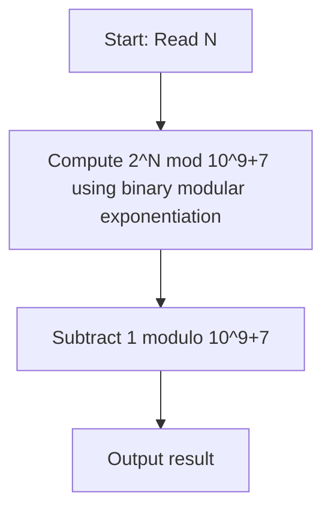

# Missing some chairs (CodeChef CC-MCHAIRS)

## 1. Problem Overview
- **Platform:** CodeChef
- **Problem ID:** [CC-MCHAIRS](https://www.codechef.com/problems/MCHAIRS)
- **Difficulty / Rating:** 1456
- **Tags:** codechef, math, combinatorics, modular exponentiation
- **Solution File:** `missingSomeChairs.js`
- **Starter Template:** `templates/codechef.js`

---

## 2. Core Intuition & Mathematical Rationale
The teacher has $N$ students and wants to seat $K$ students on $K$ distinct chairs, where $K$ ranges from 1 to $N$.
For a fixed $K$, the number of ways to choose $K$ students from $N$ is $\binom{N}{K}$.
Summing over all possible chair counts from $K = 1$ to $N$:
$$\sum_{K=1}^N \binom{N}{K} = 2^N - 1 \pmod{10^9+7}$$
Using binary modular exponentiation, $2^N \pmod{10^9+7}$ is computed in $O(\log N)$ steps, after which subtracting 1 modulo $10^9+7$ yields the answer.



---

## 3. Algorithmic Complexity

| Dimension | Bound | Proof & Rationale |
|---|:---:|---|
| **Time Complexity** | $O(\log N)$ | $\approx 27$ multiplications for $N \le 10^8$. |
| **Space Complexity** | $O(1)$ | BigInt arithmetic scalars. |
| **Recursion Depth** | $O(1)$ | Fully iterative execution. |

---

## 4. Idiomatic Implementation
```javascript
// Reference: solutions/missingSomeChairs.js
```
