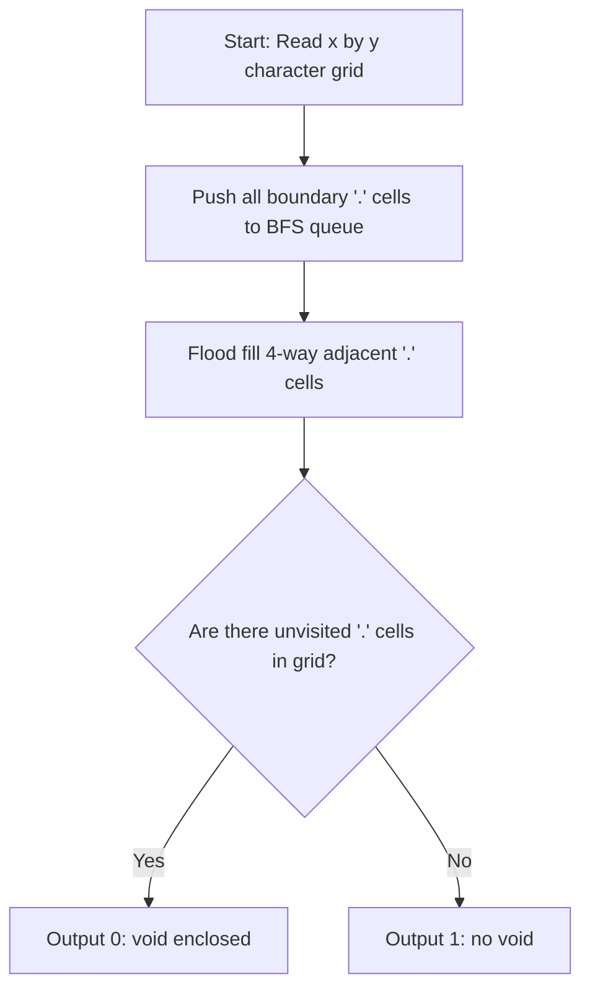

# One or Zero(keteki) (CodeChef CC-QM20A)

## 1. Problem Overview
- **Platform:** CodeChef
- **Problem ID:** [CC-QM20A](https://www.codechef.com/problems/QM20A)
- **Difficulty / Rating:** 1450
- **Tags:** codechef, bfs, flood fill, grid
- **Solution File:** `oneOrZeroKeteki.js`
- **Starter Template:** `templates/codechef.js`

---

## 2. Core Intuition & Mathematical Rationale
A 2D binary pixel character `'0'` encloses an interior empty region (void) disconnected from the outer perimeter, whereas a `'1'` contains no enclosed loop.
Using 4-directional flood fill (BFS):
- Enqueue all empty cells `'.'` lying on the grid boundaries (top, bottom, left, right borders).
- Propagate BFS across reachable `'.'` cells.
- Any unvisited `'.'` remaining after flood fill must be enclosed entirely by `'#'` boundaries (a void).
- If an unvisited empty cell exists, the digit is `'0'`; otherwise, it is `'1'`.



---

## 3. Algorithmic Complexity

| Dimension | Bound | Proof & Rationale |
|---|:---:|---|
| **Time Complexity** | $O(x \cdot y)$ | Every cell in the grid is enqueued at most once ($x, y \le 50$). |
| **Space Complexity** | $O(x \cdot y)$ | Visited bitmask array and flat queue. |
| **Recursion Depth** | $O(1)$ | Fully iterative BFS. |

---

## 4. Idiomatic Implementation
```javascript
// Reference: solutions/oneOrZeroKeteki.js
```
