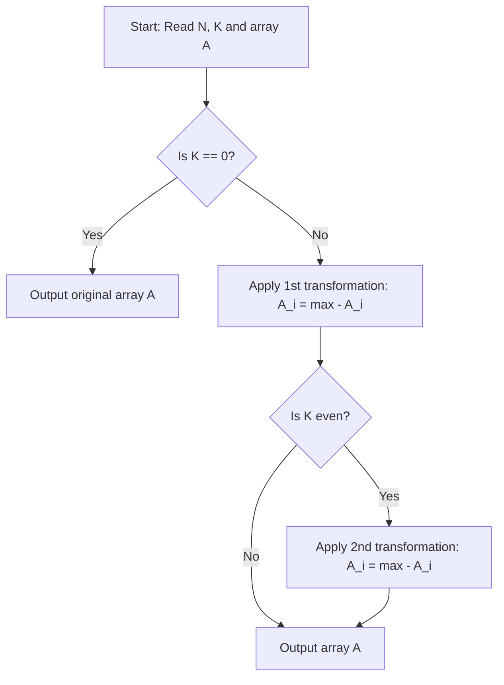

# Stone (CodeChef CC-RRSTONE)

## 1. Problem Overview
- **Platform:** CodeChef
- **Problem ID:** [CC-RRSTONE](https://www.codechef.com/problems/RRSTONE)
- **Difficulty / Rating:** 1489
- **Tags:** codechef, math, constructive algorithms
- **Solution File:** `stone.js`
- **Starter Template:** `templates/codechef.js`

---

## 2. Core Intuition & Mathematical Rationale
The operation replaces every element with $\max(A) - A_i$.
- For $K = 0$, the array is untouched.
- For $K = 1$, each element becomes $\max(A) - A_i$.
- For $K = 2$, each element is subtracted from the new maximum.
- For any $K \ge 1$, the transformations alternate between two fixed states (period 2).
Thus, if $K$ is odd, the final array equals the state after 1 operation; if $K$ is even ($K > 0$), it equals the state after 2 operations.



---

## 3. Algorithmic Complexity

| Dimension | Bound | Proof & Rationale |
|---|:---:|---|
| **Time Complexity** | $O(N)$ | At most two linear scans of size $N$. |
| **Space Complexity** | $O(N)$ | Typed Float64Array storing elements. |
| **Recursion Depth** | $O(1)$ | Fully iterative execution. |

---

## 4. Idiomatic Implementation
```javascript
// Reference: solutions/stone.js
```
