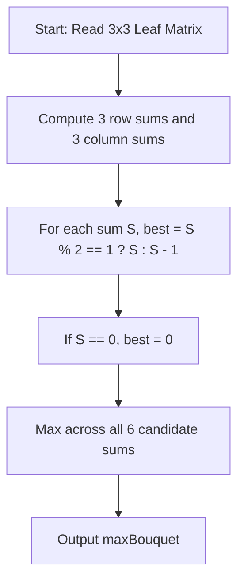

# The Largest Bouquet (CodeChef CC-BOUQUET)

## 1. Problem Overview
- **Platform:** CodeChef
- **Problem ID:** [CC-BOUQUET](https://www.codechef.com/problems/BOUQUET)
- **Difficulty / Rating:** 1423
- **Tags:** codechef, math, greedy
- **Solution File:** `theLargestBouquet.js`
- **Starter Template:** `templates/codechef.js`

---

## 2. Core Intuition & Mathematical Rationale
Leaves are categorized across 3 types (maple, oak, poplar) and 3 colors (green, yellow, red), forming a $3 \times 3$ matrix.
A bouquet is nice if all selected leaves share either the same tree type or the same color, with the total number of leaves being strictly odd (or 0 if no valid bouquet exists).
There are exactly 6 candidate pools:
- 3 tree type pools (row sums of the matrix)
- 3 color pools (column sums of the matrix)
For any pool with total sum $S$:
- If $S = 0$, the maximum odd subset size is $0$.
- If $S$ is odd, all $S$ leaves can be used.
- If $S$ is even ($S > 0$), omitting one leaf yields $S - 1$ leaves, the largest odd integer $\le S$.
The answer is the maximum over all 6 pool capacities.



---

## 3. Algorithmic Complexity

| Dimension | Bound | Proof & Rationale |
|---|:---:|---|
| **Time Complexity** | $O(1)$ | Constant 9 additions and 6 parity checks per testcase. |
| **Space Complexity** | $O(1)$ | Fixed array of 6 sums. |
| **Recursion Depth** | $O(1)$ | Fully iterative execution. |

---

## 4. Idiomatic Implementation
```javascript
// Reference: solutions/theLargestBouquet.js
```
