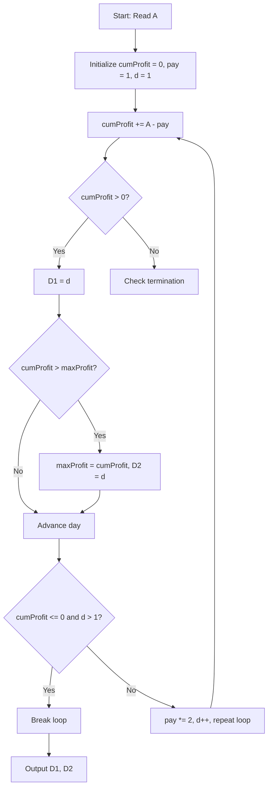

# The Tricky Deal (CodeChef CC-TRICKYDL)

## 1. Problem Overview
- **Platform:** CodeChef
- **Problem ID:** [CC-TRICKYDL](https://www.codechef.com/problems/TRICKYDL)
- **Difficulty / Rating:** 1431
- **Tags:** codechef, math, greedy, simulation
- **Solution File:** `theTrickyDeal.js`
- **Starter Template:** `templates/codechef.js`

---

## 2. Core Intuition & Mathematical Rationale
On day $d$, Chef receives $A$ rupees and pays $2^{d-1}$ rupees.
The cumulative net profit after $d$ days is:
$$Profit(d) = d \cdot A - (2^d - 1)$$
Because $2^{d-1}$ doubles each day, it quickly overtakes $A$. For any $A \le 10^9$, $2^{d-1} > A$ by $d = 31$, and cumulative profit turns permanently negative by $d \le 40$.
Simulating day by day using `BigInt` allows:
- Tracking $D_1$: the latest day $d$ with $Profit(d) > 0$.
- Tracking $D_2$: the day $d$ maximizing $Profit(d)$ (which occurs when $2^{d-1} < A$ just before the daily contribution turns negative).



---

## 3. Algorithmic Complexity

| Dimension | Bound | Proof & Rationale |
|---|:---:|---|
| **Time Complexity** | $O(\log A)$ | Loop terminates in at most $\approx 40$ steps per testcase. |
| **Space Complexity** | $O(1)$ | BigInt accumulators. |
| **Recursion Depth** | $O(1)$ | Fully iterative execution. |

---

## 4. Idiomatic Implementation
```javascript
// Reference: solutions/theTrickyDeal.js
```
