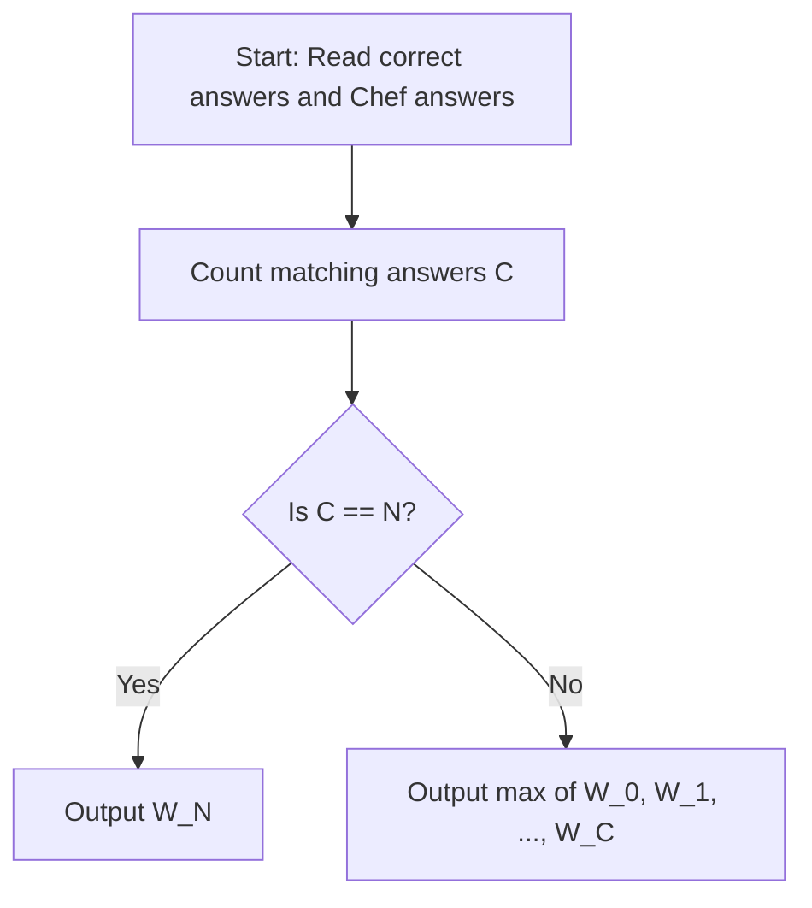

# Who dares to be a millionaire (CodeChef CC-WDTBAM)

## 1. Problem Overview
- **Platform:** CodeChef
- **Problem ID:** [CC-WDTBAM](https://www.codechef.com/problems/WDTBAM)
- **Difficulty / Rating:** 1497
- **Tags:** codechef, greedy, strings
- **Solution File:** `whoDaresToBeAMillionaire.js`
- **Starter Template:** `templates/codechef.js`

---

## 2. Core Intuition & Mathematical Rationale
Chef knows his fixed answers to all $N$ questions, with exactly $C$ answers matching the correct key.
The questions are presented in a uniformly random order, and the game terminates upon the first incorrect response.
- If $C = N$, Chef answers every question correctly regardless of the permutation, necessarily attaining $N$ correct answers and winning $W_N$.
- If $C < N$, there exists at least one question Chef answers incorrectly. Under some permutation, the incorrect question can appear after any $k \in \{0, 1, \dots, C\}$ correct answers, terminating the quiz with $k$ correct answers. Thus, Chef can potentially win any prize $W_k$ for $0 \le k \le C$. The maximum achievable prize is $\max_{0 \le k \le C} W_k$.



---

## 3. Algorithmic Complexity

| Dimension | Bound | Proof & Rationale |
|---|:---:|---|
| **Time Complexity** | $O(N)$ | Linear character comparison followed by prefix scan of length $C + 1$. |
| **Space Complexity** | $O(N)$ | Float64Array storing winnings. |
| **Recursion Depth** | $O(1)$ | Fully iterative execution. |

---

## 4. Idiomatic Implementation
```javascript
// Reference: solutions/whoDaresToBeAMillionaire.js
```
