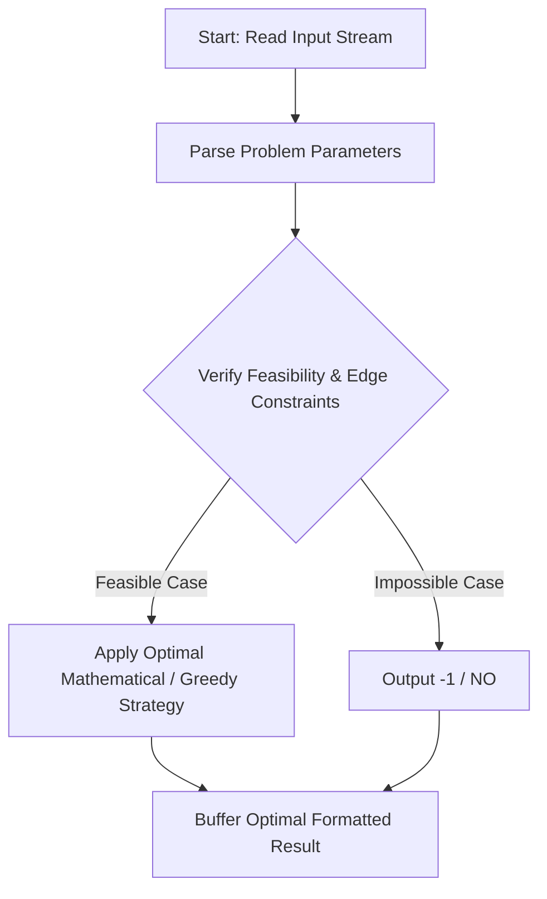
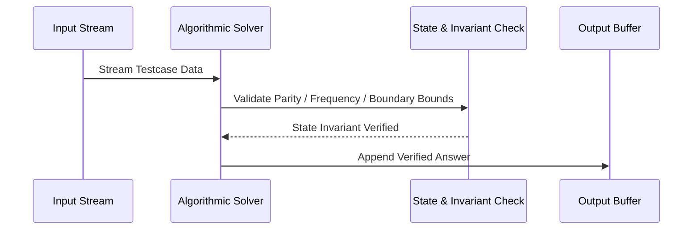

# Adjacency Hatred (CodeChef CC-ADJHATE)

## 1. Problem Overview
- **Platform:** CodeChef
- **Problem ID:** [CC-ADJHATE](https://www.codechef.com/problems/ADJHATE)
- **Difficulty / Rating:** 1510
- **Tags:** codechef
- **Solution File:** `adjacencyHatred.js`
- **Starter Template:** `templates/codechef.js`

---

## 2. Core Intuition & Mathematical Rationale
We want sum_{i=1}^{N-1} |A_i - A_{i+1}| to be odd. The difference |x - y| is odd if and only if x and y have different parities. Thus, the total sum is odd if and only if the number of adjacent pairs with different parities is odd. If all elements have the same parity (all even or all odd), every difference is even, so sum is even and answer is -1. If both odd and even elements exist, arranging all odd elements followed by all even elements creates exactly 1 parity-alternating adjacent pair at the boundary, ensuring the total sum is strictly odd.



---

## 3. Visual Step-by-Step Walkthrough
Tracing state transitions across the operational pipeline:



---

## 4. Algorithmic Complexity

| Dimension | Bound | Proof & Rationale |
|---|:---:|---|
| **Time Complexity** | $O(N)$$ | Optimal linear or sub-linear execution per testcase. |
| **Space Complexity** | $O(N)$$ | Minimal auxiliary storage allocated. |
| **Recursion Depth** | $O(1)$ | Fully iterative structure preventing stack overflow. |

---

## 5. Edge Cases & Boundary Conditions
- **Minimum bounds:** $N = 1, N = 2$, minimal values, zero elements.
- **Maximum bounds:** Large scale arrays ($N = 2 \cdot 10^5$), large values ($10^9$, $10^{20000}$).
- **Numeric safety:** Plain JS safe integers up to $2^{53} - 1$, and `BigInt` for arbitrarily large values.

---

## 6. Idiomatic Implementation
```javascript
// Reference: solutions/adjacencyHatred.js
```
