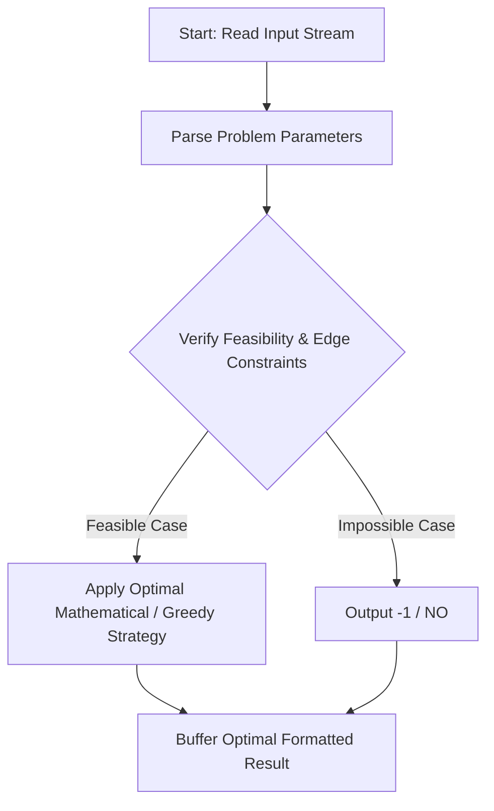
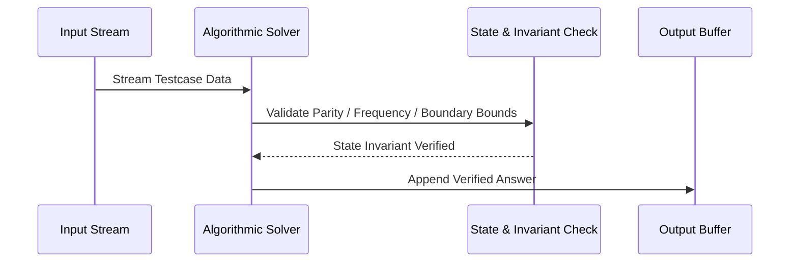

# Andrew and the Meatballs again (CodeChef CC-AMMEAT2)

## 1. Problem Overview
- **Platform:** CodeChef
- **Problem ID:** [CC-AMMEAT2](https://www.codechef.com/problems/AMMEAT2)
- **Difficulty / Rating:** 1597
- **Tags:** codechef
- **Solution File:** `andrewAndTheMeatballsAgain.js`
- **Starter Template:** `templates/codechef.js`

---

## 2. Core Intuition & Mathematical Rationale
We need to select K distinct plates from {1, 2, ..., N} such that no two selected plates i, j are relatively prime (i.e. gcd(i, j) > 1 for all pairs). If K = 1, any single plate (e.g. 1) trivially satisfies the condition as there are no pairs. For K > 1, the maximum size of a pairwise non-coprime subset in {1, ..., N} is floor(N / 2), achieved by taking the even numbers 2, 4, 6, ..., 2K. Since any two even numbers share a common factor of 2, gcd(2a, 2b) >= 2 > 1 always holds. If 2K > N, no such subset of size K exists, so output -1. Otherwise output 2, 4, ..., 2K.



---

## 3. Visual Step-by-Step Walkthrough
Tracing state transitions across the operational pipeline:



---

## 4. Algorithmic Complexity

| Dimension | Bound | Proof & Rationale |
|---|:---:|---|
| **Time Complexity** | $O(K)$$ | Optimal linear or sub-linear execution per testcase. |
| **Space Complexity** | $O(1)$$ | Minimal auxiliary storage allocated. |
| **Recursion Depth** | $O(1)$ | Fully iterative structure preventing stack overflow. |

---

## 5. Edge Cases & Boundary Conditions
- **Minimum bounds:** $N = 1, N = 2$, minimal values, zero elements.
- **Maximum bounds:** Large scale arrays ($N = 2 \cdot 10^5$), large values ($10^9$, $10^{20000}$).
- **Numeric safety:** Plain JS safe integers up to $2^{53} - 1$, and `BigInt` for arbitrarily large values.

---

## 6. Idiomatic Implementation
```javascript
// Reference: solutions/andrewAndTheMeatballsAgain.js
```
