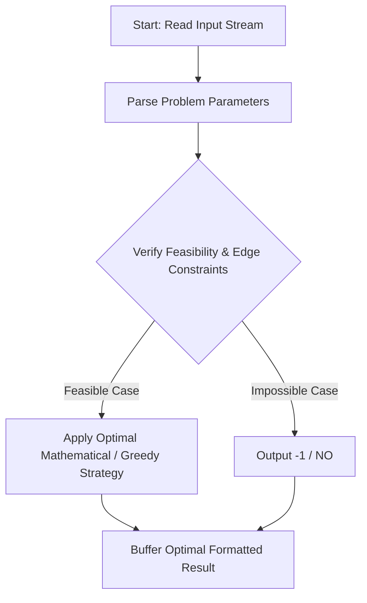
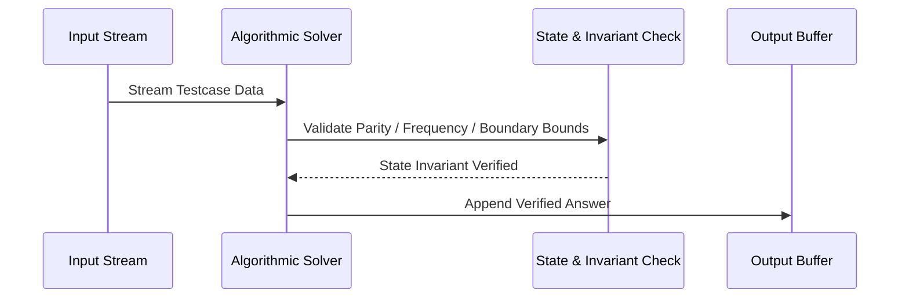

# Array Removal (CodeChef CC-ARRREM)

## 1. Problem Overview
- **Platform:** CodeChef
- **Problem ID:** [CC-ARRREM](https://www.codechef.com/problems/ARRREM)
- **Difficulty / Rating:** 1550
- **Tags:** codechef
- **Solution File:** `arrayRemoval.js`
- **Starter Template:** `templates/codechef.js`

---

## 2. Core Intuition & Mathematical Rationale
We want the bitwise OR of retained elements to equal 2^x - 1 for some x >= 0, minimizing removals. An element can be retained only if all its set bits are < x, i.e., A_i < 2^x. For each candidate x in [1, 31], we consider all elements with A_i < 2^x. If their cumulative bitwise OR equals 2^x - 1, we can retain all such elements, requiring N - count removals. Sorting A ascending allows prefix iteration in O(N log N) to find the minimum removals over all valid x.



---

## 3. Visual Step-by-Step Walkthrough
Tracing state transitions across the operational pipeline:



---

## 4. Algorithmic Complexity

| Dimension | Bound | Proof & Rationale |
|---|:---:|---|
| **Time Complexity** | $O(N log N)$$ | Optimal linear or sub-linear execution per testcase. |
| **Space Complexity** | $O(N)$$ | Minimal auxiliary storage allocated. |
| **Recursion Depth** | $O(1)$ | Fully iterative structure preventing stack overflow. |

---

## 5. Edge Cases & Boundary Conditions
- **Minimum bounds:** $N = 1, N = 2$, minimal values, zero elements.
- **Maximum bounds:** Large scale arrays ($N = 2 \cdot 10^5$), large values ($10^9$, $10^{20000}$).
- **Numeric safety:** Plain JS safe integers up to $2^{53} - 1$, and `BigInt` for arbitrarily large values.

---

## 6. Idiomatic Implementation
```javascript
// Reference: solutions/arrayRemoval.js
```
